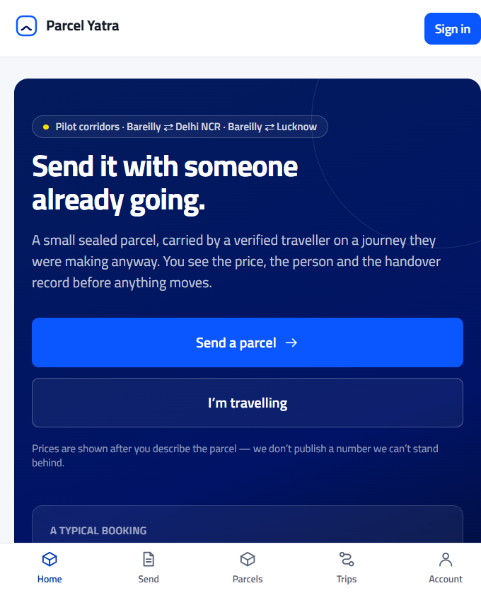
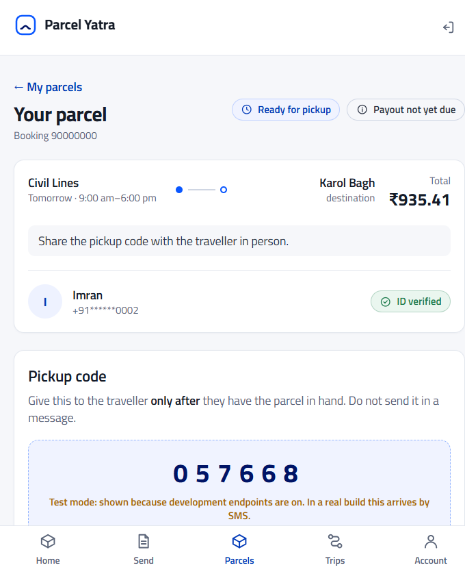

# Parcel Yatra

An inter-city parcel marketplace for the Bareilly ⇄ Delhi NCR and Bareilly ⇄ Lucknow corridors.
A sender posts a parcel; a verified traveller who is already making that journey carries it. Both
sides confirm handover with one-time codes, and the sender can raise a problem for 72 hours after
delivery.

**This is a pilot build. Payments are sandbox-only. Payouts are disabled. It is not production-ready
and it makes no compliance, security or market claim.** Read
[`docs/BUILD_NOTES.md`](docs/BUILD_NOTES.md) before using it for anything real, and
[`parcel-yatra-startup-pack/AGENTS.md`](parcel-yatra-startup-pack/AGENTS.md) for the rules the pack
sets.

---

## What works

- Phone OTP sign-in (sandbox), sessions, refresh rotation.
- Send wizard: route, category, weight, prohibited-item checks, pilot limits, live quote.
- Matching against published trips, with a reason code on every match.
- Booking: request → accept → sandbox payment → pickup code → in transit → arrived → delivery code.
- Verification submission (photo ID + selfie) and a staff decision queue.
- 72-hour problem window, case evidence, staff resolution, payout freeze.
- Traveller trip publishing (car only at pilot).
- Staff console: verification queue, booking search, case queue, refund approval, audit log.
- Static pricing, prohibited items, safety, help, and draft legal pages.
- An Expo (React Native) app in `apps/mobile` that uses the same API and session rules; see
  [`docs/BUILD_NOTES.md` §6](docs/BUILD_NOTES.md#6-mobile-app-expo--what-exists-and-what-it-refuses-to-fake).

## What is deliberately off

| Thing | State |
| --- | --- |
| Live payments | Refused at boot. `PAYMENTS_LIVE=true` is a startup error. |
| Payout release | `501 PAYOUTS_NOT_ENABLED`. |
| Split case settlement | `501 SPLIT_SETTLEMENT_NOT_ENABLED`; the staff option is disabled. |
| Bike / bus / train / air | Refused at boot; car only. |
| External SMS / email | None. Notifications are in-app rows only. |
| Real object storage | Local authenticated upload sink (dev only). |
| Aadhaar | Never collected or stored. |

---

## Run it

Requirements: **Node 22+** (built on 24), npm 10+. No Docker, no external database.

```powershell
npm install
Copy-Item .env.example .env
npm run dev
```

- Web: <http://localhost:5173>
- API: <http://127.0.0.1:3000/v1/health>
- Mobile: `npm run start -w @py/mobile`, then open the project in Expo Go (SDK 58 includes the
  community date picker) or a development build. Nothing was launched here — no phone, emulator or
  Android SDK exists on the build machine; see `docs/BUILD_NOTES.md` §6.

First boot applies `apps/api/src/db/schema.sql` to an embedded PGlite database in
`apps/api/data/pgdata` and seeds demo data. The web dev server proxies `/v1` to the API, so the
browser sees one origin.

Run the two apps separately if you prefer:

```powershell
npm run dev:api
npm run dev:web
```

### Demo accounts (development seed only)

The OTP is shown on the login screen in dev ("Fill NNNNNN and continue"), on the web app and on the
mobile app's local preview when it points at a dev API. No SMS is sent.

| Phone | Name | What it is |
| --- | --- | --- |
| `+91 90000 00001` | Aarti Verma | Sender. Not verified as a traveller. |
| `+91 90000 00002` | Imran Sheikh | Verified traveller, has a Bareilly → Delhi trip. |
| `+91 90000 00003` | Neha Chauhan | Verified traveller, has a Bareilly → Lucknow trip. |
| `+91 90000 00009` | Ops Demo | Staff: all console roles. Console at `/admin`. |

These numbers, names and trips are fictional. Do not treat them as real users or real demand.

### Scripts

| Command | Does |
| --- | --- |
| `npm run dev` | API + web together. |
| `npm run typecheck` | TypeScript for domain, API, web and mobile. |
| `npm test` | Domain, API and mobile test suites. |
| `npm run build` | Bundle the API (esbuild) and build the web app (Vite). |
| `npm run db:migrate` | Apply `schema.sql` to the configured database. |
| `npm run db:seed` | Insert demo data. |
| `npm run db:reset` | Drop and rebuild the local database. |
| `node scripts/smoke.mjs` | 43-check HTTP smoke test against a running API. |
| `node scripts/smoke.mjs --reset` | Same, after restoring the seed (use this on a used database). |

The smoke test caches tokens in `.smoke-tokens.json` because sign-in is rate limited per number.
Both the cache and `apps/api/data/` are gitignored.

---

## Layout

```
apps/
  api/            Fastify + PGlite. Routes in src/routes, schema in src/db/schema.sql.
    data/         Local database and uploads (gitignored).
  web/            Vite + React 19 + TypeScript + Tailwind v4 + React Router + TanStack Query.
    src/screens/  One file per screen; /admin is lazy-loaded and staff-gated.
  mobile/         Expo SDK 58 + Expo Router. Routes in app/, shared code in src/. Android/iOS target;
                  a React Native Web preview exists for local development only.
packages/
  domain/         Framework-free pricing, enums, booking state machine, status copy. 15 tests.
scripts/
  smoke.mjs       End-to-end HTTP checks.
docs/
  BUILD_NOTES.md  Every departure from the pack, and every known gap.
parcel-yatra-startup-pack/
                  The specification. Treat it as read-only source material.
```

Money is an integer number of paise everywhere (`*_paise`). The server computes every amount; a
client-supplied amount is ignored. The pricing formula is `v1.0` and is a **hypothesis** from the
pack, not a measured market rate.

## Design

The visual language follows Porter's public site: **Titillium Web** (SIL Open Font License, bundled
via `@fontsource/titillium-web`) with a blue-led palette.

| Token | Value |
| --- | --- |
| Brand | `#0A57FF` / `#2962FF` |
| Deep brand | `#0039B8` |
| Navy | `#001366` |
| Ink | `#151C28` |
| Tint | `#F0F3FF` / `#EEF2FF` |
| Yellow accent | `#FEDF00` |
| Radii | 8–10 px and pills |

Only the font and colour language are borrowed. No Porter copy, layout, imagery or other asset is
copied.

## Screens

| Landing | Booking, ready for pickup |
| --- | --- |
|  |  |

Both were captured from the development build, which is why the "Test mode" chips and the visible
pickup code appear. In a real build the code arrives by SMS and none of those affordances exist.

---

## Safety rails in code

- `assertSafetyRails()` runs before the server listens. It refuses production with sandbox-only
  settings, dev endpoints, mock payments, default secrets, non-car modes, or a shared admin origin.
- `ENABLE_DEV_ENDPOINTS` is refused in production. Dev routes reveal sandbox OTPs, simulate signed
  webhooks, advance a booking, and reset the seed.
- Every "not yours" path returns `NOT_FOUND`, never `403`, so the API does not disclose that a
  resource exists.
- Uploads are JPEG/PNG only, ≤10 MB, and scoped to the caller's own object key.
- Payout release and split settlement return `501` rather than pretending to move money.

## Gates that are still open

The build does not close any launch gate. From
`parcel-yatra-startup-pack/legal/LEGAL_REGULATORY_MATRIX.md` §8:

- **GATE-1** counsel memo on marketplace classification and ToS liability.
- **GATE-2** written confirmation that car-based peer carriage needs no transport permit.
- **GATE-3** payment provider written confirmation of the fund-flow model.
- **GATE-4** GST/tax opinion on invoicing and TDS.
- **GATE-5** insurance position, or a prominent "uninsured" disclosure.
- **GATE-6** DPDP-aligned notice, consent records and deletion process.
- **GATE-7** grievance officer appointed and published.

Until GATE-3 closes in writing, no real money may move through this code.

## Licence and legal documents

The legal pages in the app are **drafts**. They are not legal advice and have not been reviewed by a
qualified Indian lawyer. The pack's `legal/` directory holds the drafts; do not present either as
binding.

Titillium Web is licensed under the SIL Open Font License 1.1. The rest of this repository is
internal pilot material; no licence for redistribution has been granted.
