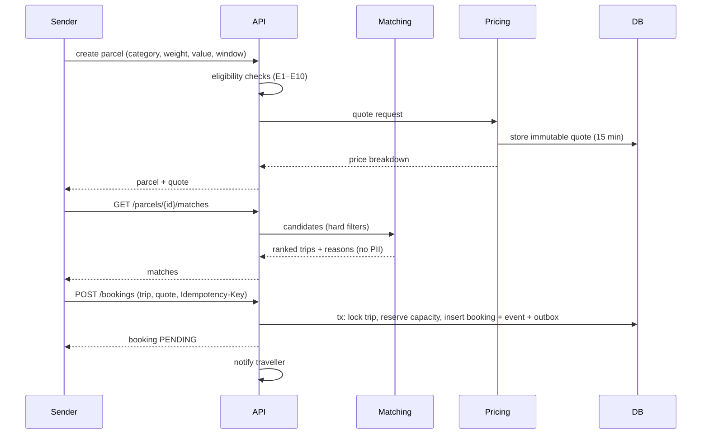
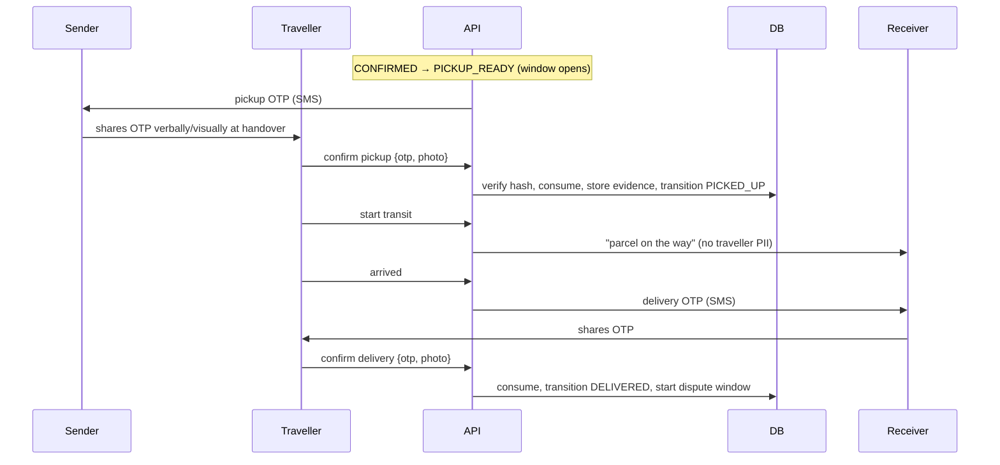
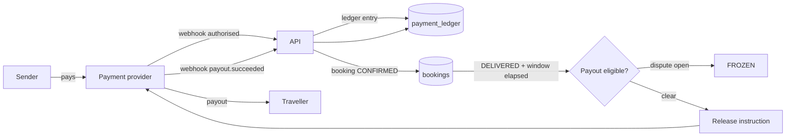
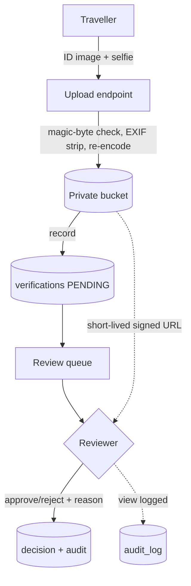
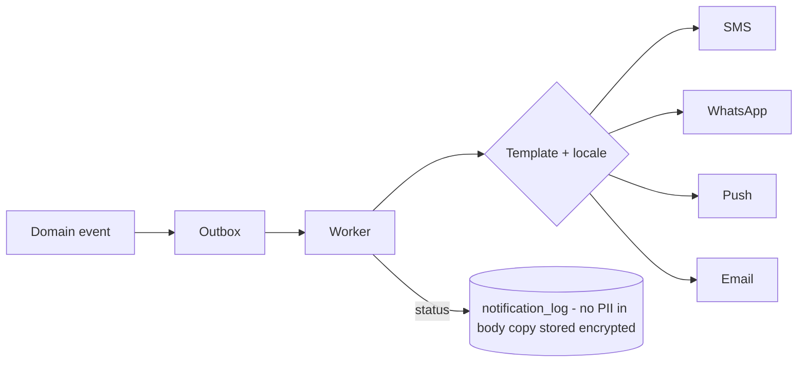
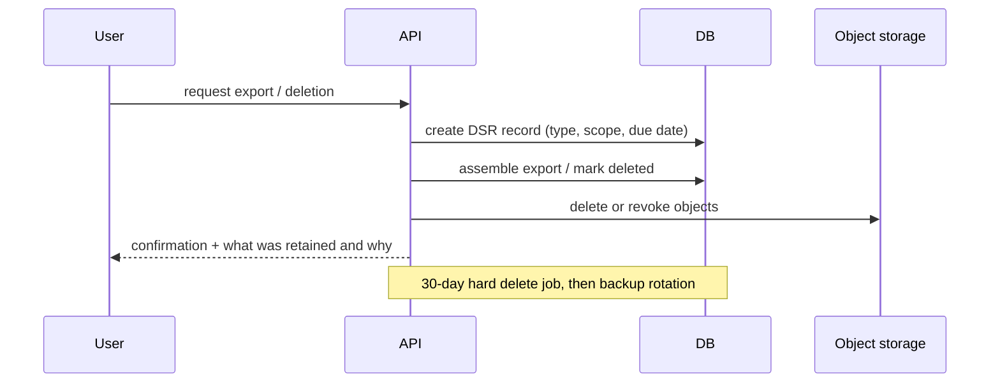

# Data Flow Diagrams

**Status:** Draft v0.1 · **Date:** 2026-10-24

---

## 1. Sender → booking (happy path)

## 2. Handover and delivery

## 3. Money flow (sandbox until gates)

**Critical:** Parcel Yatra never appears as the holder of funds in this diagram.

## 4. Verification data flow

## 5. Notification fan-out

## 6. Data subject request flow

## 7. Where PII goes (and does not)

| Flow | PII present | Control |
|---|---|---|
| Matching results | Area, first name, rating band | No phone/address |
| Booking confirmation | Full name, masked phone | Post-match only |
| Handover | OTP (hashed at rest) | Never logged |
| Delivery | Receiver phone | Deleted/masked after 30 d |
| Notifications | Phone, first name | Templates reviewed, no item details |
| Analytics | Pseudonymous user id | No PII |
| Error tracking | Scrubbed | Denylist enforced |
