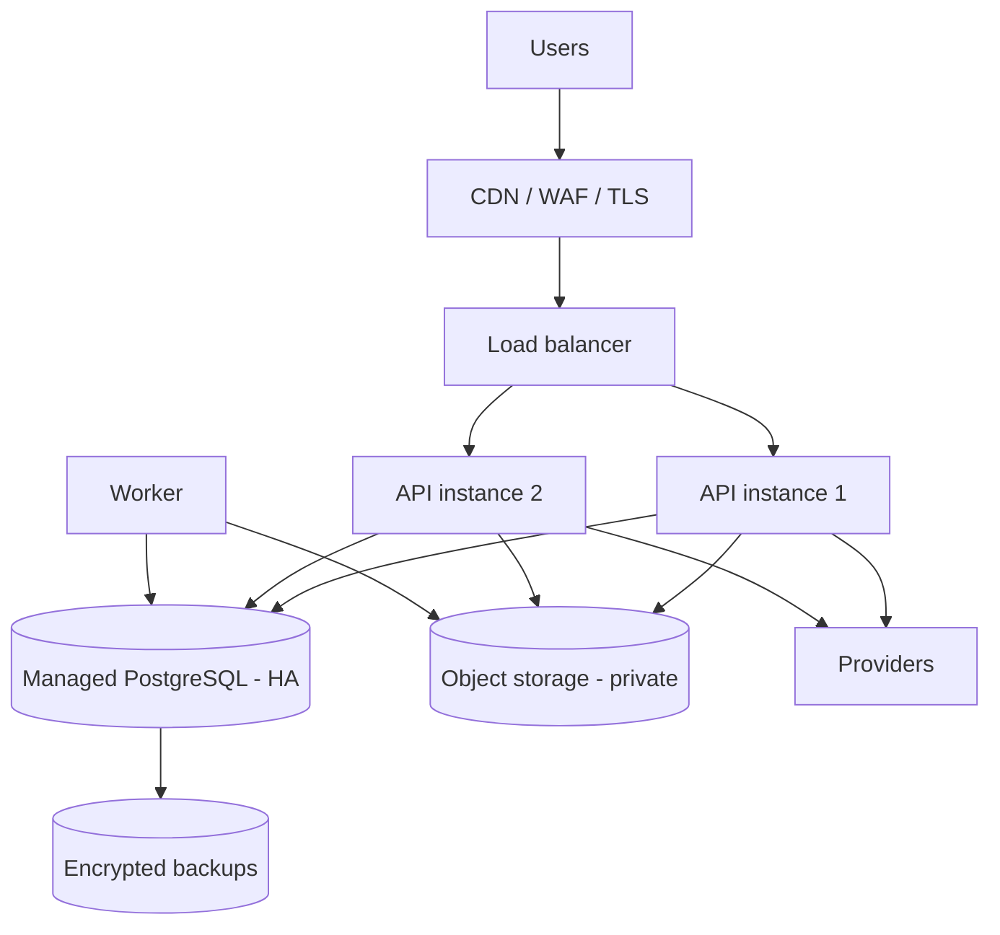

# Deployment Architecture

**Status:** Draft v0.1 · **Date:** 2026-10-24

---

## 1. Pilot topology (single region — India)



**Sizing (pilot):** 2 × small API instances (0.5–1 vCPU), 1 worker, managed Postgres (small HA), object
storage, CDN. Capacity target: 50 rps reads / 10 rps writes.

## 2. Environments

| Environment | Purpose | Data | Payments | Access |
|---|---|---|---|---|
| `local` | Development | Seed/mock | Mock adapter | Developer |
| `test` | Automated tests (ephemeral) | Fixtures | Mock | CI |
| `staging` | Pre-production verification | Synthetic | Sandbox | Team |
| `production` | Live pilot | Real | **Sandbox until gates** | Restricted |

Production is **not** used for testing. No production data in staging.

## 3. Release flow

```
PR → CI (lint, typecheck, unit, integration, contract, secret scan, SAST)
   → review (required)
   → merge to main
   → build image (immutable tag = git sha)
   → deploy staging → smoke + migration check
   → manual approval
   → deploy production (rolling, 2 instances)
   → post-deploy smoke + monitoring window
```

## 4. Migrations in deployment

| Rule | Detail |
|---|---|
| Expand/contract | Add columns nullable → backfill → switch reads → drop later |
| No destructive migration without backup + approval |
| Every migration reversible or explicitly forward-only with a documented recovery |
| Migrations run as a separate step, not in app boot |
| Long locks avoided (use `CONCURRENTLY` for indexes) |

## 5. Scaling path (incremental)

| Trigger | Action |
|---|---|
| CPU > 60% sustained | Add API replica |
| Reads slow | Add read replica for analytics/admin |
| Job lag > 5 min | Scale worker; then consider Redis queue |
| DB > 70% storage | Archive old bookings; partition events |
| > 100 rps | Consider caching hot matching queries |
| Multi-region needed | Only after product-market fit; not pilot |

## 6. Cost estimate (pilot, monthly, HYPOTHESIS)

| Item | Estimate (₹) |
|---|---|
| API compute (2 small) | 1,600 |
| Worker | 600 |
| Managed Postgres (HA, small) | 3,500 |
| Object storage + egress | 800 |
| CDN/WAF | 700 |
| Backups | 500 |
| SMS/OTP (2,000 msgs) | 400 |
| WhatsApp/push/email | 600 |
| Error tracking + logs | 1,200 |
| Domain/certs/misc | 300 |
| **Total** | **≈ 10,200** |

Plus KYC vendor per-verification fees and any map API usage. **These are estimates, not quotes.**

## 7. Backup & DR

| Item | Value |
|---|---|
| DB backup | Continuous PITR + daily snapshot |
| Retention | 35 days |
| RPO | ≤ 5 min |
| RTO | ≤ 2 h |
| Restore test | Quarterly, documented |
| Object storage | Versioning on, lifecycle rules |
| Secrets backup | Out-of-band, break-glass procedure |

## 8. Observability

| Signal | Tool | Alert |
|---|---|---|
| HTTP errors/latency | APM/metrics | 5xx > 1% for 5 min |
| Business funnel | Events | booking creation drops > 50% vs baseline |
| Payment webhooks | Logs + metric | signature failures > 0 |
| Job lag | Metric | > 5 min |
| Backup failure | Provider | any failure |
| Uptime | External monitor | 2 consecutive failures |

## 9. Security posture of the deployment

- Private subnets for DB; no public IP.
- Security groups: API → DB only from API SG.
- Least-privilege IAM per component.
- No SSH to app instances (managed platform or SSM-style access).
- Secrets injected at runtime.
- Image scanning in CI.

## 10. Explicit non-goals at pilot

Kubernetes, multi-region, service mesh, blue/green with automated canary analysis, self-hosted DB.
