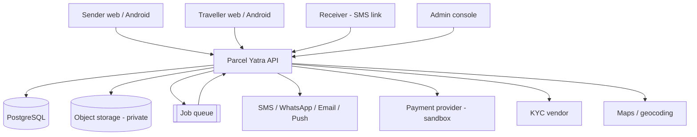
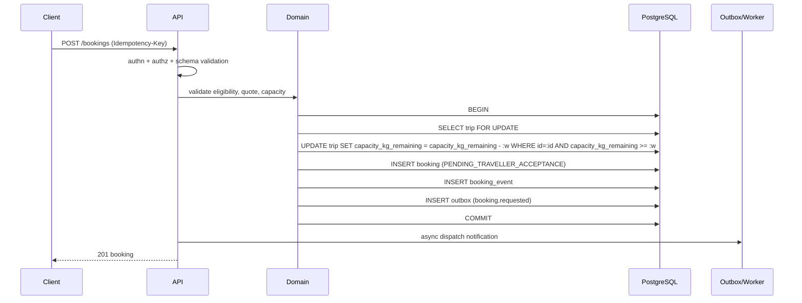

# System Architecture

**Status:** Draft v0.1 · **Date:** 2026-10-24
**Style:** modular monolith, single deployable API, PostgreSQL, adapter-based integrations.

---

## 1. Context



## 2. Why a modular monolith

| Consideration | Monolith | Microservices |
|---|---|---|
| Team size (2–4) | ✅ one deploy, one debug surface | ❌ operational overhead |
| Transactional integrity (capacity, money) | ✅ single DB transaction | ❌ distributed sagas |
| Consistency for booking state | ✅ trivial | ❌ eventual consistency risk |
| Scaling | ⚠️ vertical + replicas | ✅ per-service |
| Cost at pilot | ✅ low | ❌ high |

We can split later if a specific module needs it. `docs/DECISIONS_AND_ASSUMPTIONS.md` D-002.

## 3. Modules (enforced boundaries)

| Module | Owns | May call |
|---|---|---|
| `identity` | OTP, sessions, Google, roles | `users` (read) |
| `users` | profile, status, preferences | — |
| `verification` | KYC submission, decisions | `users`, storage |
| `parcels` | parcel creation, eligibility | `pricing` (read), `catalog` |
| `trips` | trip creation, capacity | `users` |
| `matching` | candidate search, scoring | `trips`, `parcels` |
| `bookings` | state machine, lifecycle | all of the above (via interfaces) |
| `handover` | OTP, proof, evidence | `bookings` |
| `payments` | intents, webhooks, ledger | provider adapter |
| `payouts` | eligibility, release | `payments`, `disputes` |
| `disputes` | cases, outcomes | `bookings`, `payments` |
| `reviews` | ratings | `bookings` |
| `notifications` | templating, delivery | providers |
| `admin` | queues, search, actions | all (read/write via services) |
| `analytics` | events, reporting | read models |

**Rule:** cross-module writes go through a service interface, never a direct table write. Enforced by
lint rule / dependency-cruiser config.

## 4. Runtime shape

```
apps/
  api/          Fastify HTTP server (REST)
  worker/       background jobs (timers, reconciliation, retention)
  admin-web/    admin console (separate origin)
  web/          sender/traveller web (Next.js)
  mobile/       React Native (Expo)
packages/
  domain/       pure business logic (state machine, pricing, matching, refunds)
  db/           schema, migrations, repositories
  contracts/    OpenAPI-generated types
  providers/    payment, sms, kyc, maps adapters
```

`domain` must be pure: no I/O, no framework imports → unit-testable without a database.

## 5. Technology choices

| Concern | Choice | Justification |
|---|---|---|
| API framework | **Fastify** | Small surface, schema-first validation, fast, low memory |
| Language | TypeScript (strict) | Shared types across web/mobile/api |
| ORM/query | Query builder + SQL (e.g. Kysely/Drizzle) | Explicit SQL, no hidden N+1, easy indexing review |
| DB | PostgreSQL 16 | Transactions, constraints, JSONB, mature ops |
| Geo | Plain lat/lng + bounding box at pilot; PostGIS optional | City-level matching doesn't need geometry types yet |
| Queue | Postgres-backed job table first; Redis/BullMQ only if throughput demands | Avoid extra infra at pilot |
| Cache | None at pilot | Premature; measure first |
| Object storage | S3-compatible, private, India region | Signed URLs, lifecycle rules |
| Web | Next.js + TypeScript | SSR for landing/SEO, shared design system |
| Mobile | React Native + Expo | One codebase, OTA updates, native modules when needed |
| Auth | Managed OTP/SMS provider + server-side Google verification; own session layer | Control over OTP rules and audit |
| Maps | Adapter; evaluate India accuracy + cost | Avoid lock-in, control PII sent |
| Observability | Structured logs + error tracker + metrics | Minimum viable |

## 6. Request flow (booking creation)



## 7. Cross-cutting concerns

| Concern | Approach |
|---|---|
| Auth | Bearer access token (30 min) + rotating refresh; mobile secure storage |
| Validation | JSON Schema per route; reject unknown props |
| Errors | Central error handler → catalogue codes, no internals |
| Idempotency | `idempotency_keys` table keyed by (user, route, key) with response snapshot |
| Audit | `audit_log` append-only, hash-chained |
| Rate limiting | Per-route-class, per-user + per-IP |
| Feature flags | DB-backed, cached, default off |
| Config | Env + secret store; validated at boot (fail fast) |
| Time | Store UTC; render IST; all timers UTC |

## 8. Non-goals in this architecture

- Event sourcing (we use an event *log* for bookings, not as the system of record for money).
- CQRS with separate read DB.
- Microservices, service mesh, Kubernetes at pilot.
- GraphQL.
- Real-time websockets for location.

## 9. Risks

| Risk | Mitigation |
|---|---|
| Monolith becomes tangled | Module boundaries + dependency lint + code review |
| Postgres single point of failure | Managed HA, PITR, tested restore |
| Provider outage blocks bookings | Adapters with graceful degradation |
| Capacity race conditions | Explicit locking + concurrency tests |
