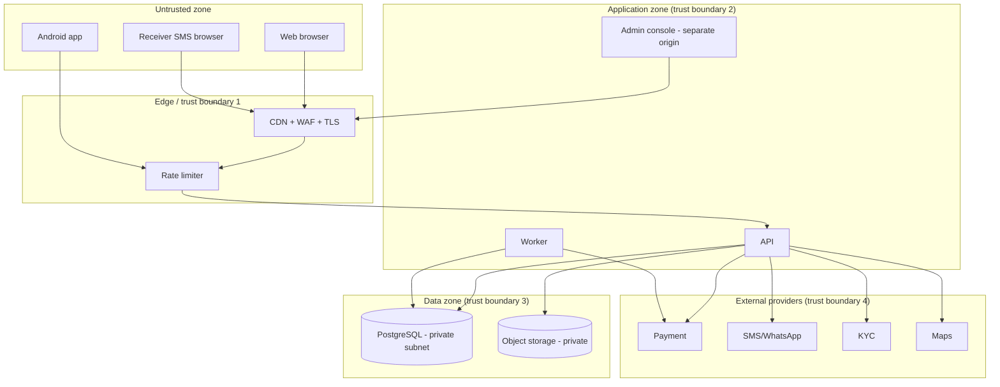

# Threat Boundaries

**Status:** Draft v0.1 · **Date:** 2026-10-24
Companion to `security/THREAT_MODEL.md` — this file maps **where** controls must sit.

---

## 1. Boundary diagram

## 2. Controls per boundary

| Boundary | Direction | Controls |
|---|---|---|
| TB1 Internet → CDN | in | TLS termination, WAF rules, DDoS protection, HSTS |
| TB1 CDN → API | in | Rate limits per route class, request size caps, auth required except public routes |
| TB2 App → API | in | Token auth, schema validation, object-level authz, no trust in client state |
| TB2 Admin → API | in | Separate session, MFA, IP allowlist, step-up, full audit |
| TB3 API → DB | out | Private network, least-privilege DB user, parameterised queries, connection pool limits |
| TB3 API → Object storage | out | Private bucket, short-lived signed URLs, no listing permission |
| TB4 API ↔ Payment | both | HMAC signature verify, timestamp window, replay cache, idempotency, allowlisted IPs |
| TB5 API → Notifications | out | PII minimisation in templates, per-provider rate caps, no OTP in logs |
| TB6 API → KYC | out | Encrypted transport, purpose-limited payload, retention instruction, DPA |
| TB7 Worker → DB | out | Same privileges as API; jobs idempotent |
| TB8 CI → Prod | in | Branch protection, signed artifacts, secret injection, no console writes |

## 3. Data classification by store

| Data | Store | Encryption | Access |
|---|---|---|---|
| ID images | Object storage (private bucket) | SSE + app-level envelope | `verification_reviewer` only, audited |
| Parcel photos | Object storage | SSE | matched parties + support |
| Payout account | DB `payout_accounts` | Field-level encryption | `finance` only, audited |
| Payment refs | DB `payment_ledger` | At rest | `finance`, read-only to API |
| Phone numbers | DB `users` | At rest; hashed index for lookup | API, support (masked) |
| OTP | DB `otps` | Keyed hash only | write/verify only, never read |
| Audit log | DB `audit_log` | At rest | append-only writer, auditor read |
| Backups | Object storage | Encrypted, separate key | Break-glass only |

## 4. Zero-trust rules applied internally

1. No service trusts a request because it came from "inside" the network.
2. Every privileged action re-checks role **and** object ownership.
3. Admin actions require a fresh session and MFA.
4. The worker verifies job payloads, not just job IDs.
5. Signed URLs are single-purpose, short-lived, and never logged in full.

## 5. What crosses a boundary that shouldn't

| Item | Status |
|---|---|
| Receiver phone to traveller before booking | **Blocked** — masked only |
| Exact address to traveller before confirmation | **Blocked** |
| ID image to support agent | **Blocked** unless `verification_reviewer` |
| OTP to logs/analytics | **Blocked** |
| Card data to our servers | **Blocked** (hosted fields) |
| PII to error tracker | **Blocked** via scrubbing |
| Full phone in analytics | **Blocked** (pseudonymous IDs only) |
