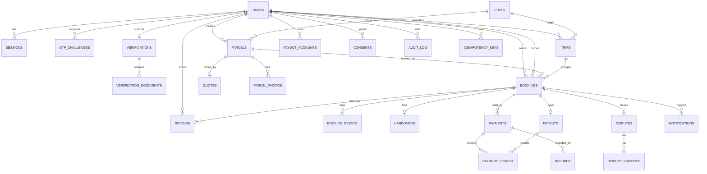

# Entity Relationship Diagram

**Status:** Draft v0.1 · **Date:** 2026-10-24
DDL: `database/SCHEMA.md` · Indexes: `database/INDEXING_AND_QUERY_PLAN.md`

---

## Cardinality notes

| Relationship | Cardinality | Rule |
|---|---|---|
| User → Verification | 1 : 0..1 (latest active) | Historical versions retained |
| Parcel → Booking | 1 : 0..n | Only one non-terminal booking at a time (partial unique index) |
| Trip → Booking | 1 : 0..n | Capacity sum must not exceed `capacity_kg` |
| Booking → Handover | 1 : 0..1 | Single handover record holding both OTP phases |
| Booking → Payment | 1 : 0..n | Retries create attempts; one successful capture |
| Booking → Payout | 1 : 0..1 | One payout per booking |
| Booking → Dispute | 1 : 0..n | Multiple disputes allowed over time, only one open |
| Booking → Review | 1 : 0..2 | One per party |

## Invariants enforced in the database

1. `bookings` partial unique index: one active booking per parcel.
2. `payments` unique on `provider_event_id` (webhook idempotency).
3. `payment_ledger` append-only (no UPDATE/DELETE grants).
4. `handover_otps` unique on `(booking_id, phase)` and single-use via `used_at`.
5. `idempotency_keys` unique on `(user_id, scope, key)`.
6. `trips.capacity_kg_remaining >= 0` CHECK.
7. `bookings` status restricted to known enum.
8. `reviews` unique on `(booking_id, author_id)`.
