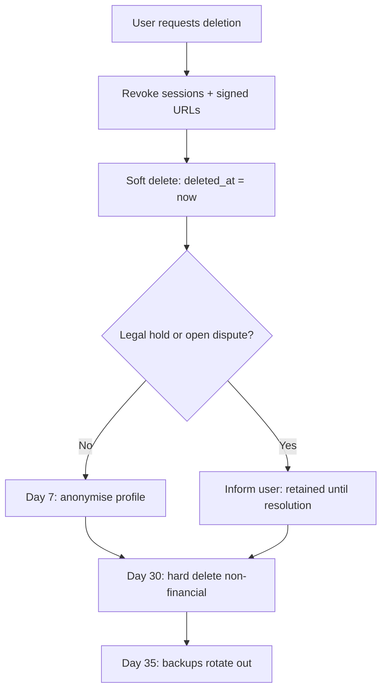

# Retention & Deletion (Database)

**Status:** Draft v0.1 · **Date:** 2026-10-24
Operational companion to `security/DATA_RETENTION_MATRIX.md`.

---

## 1. Deletion jobs

| Job | Schedule | Tables | Rule |
|---|---|---|---|
| `purge_expired_otps` | hourly | `otp_challenges`, `handover_otps` | `expires_at < now() - 24h` OR `used_at < now() - 24h` |
| `purge_id_documents` | daily | `verification_documents` | `purge_after < now()` → delete object first, then row |
| `mask_receiver_contact` | daily | `bookings` | 30 d after `delivered_at` |
| `reduce_addresses` | daily | `bookings`, `parcels` | 30 d / 180 d → null/coarsen |
| `purge_sessions` | hourly | `sessions` | `expires_at < now()` or revoked > 30 d |
| `purge_idempotency` | daily | `idempotency_keys` | `expires_at < now()` |
| `purge_notifications` | weekly | `notifications` | `created_at < now() - 180d` |
| `anonymise_deleted_users` | daily | `users` | `deleted_at < now() - 30d` |
| `purge_messages` | weekly | `messages` | 180 d after booking closed |
| `rotate_audit_archive` | monthly | `audit_log` | > 1 year → cold storage |
| `expire_backups` | daily (provider) | backups | 35 d |

## 2. Ordering rules (critical)

**Object storage before database row.** If the row is deleted first and the object delete fails, the file
becomes orphaned with no reference to find it. So:

```
1. Delete object (or mark for deletion)
2. Verify deletion
3. Delete row
4. Log deletion in audit (count only, no IDs of documents)
```

If step 1 fails → do **not** delete the row; retry next run and alert after 3 failures.

## 3. Anonymisation vs. deletion

| Data | Method |
|---|---|
| User name/email | Replace with `deleted-user-{id}` / null |
| Phone | Replace hash with a random tombstone; keep `phone_last4` only if legally needed |
| Addresses | Delete ciphertext + key reference |
| ID documents | Hard delete (object + row) |
| Booking history | Keep financial fields; null the PII links |
| Reviews | Keep stars; anonymise author |

## 4. Legal holds

If a booking is under dispute, police request, or insurer claim:
- Set `legal_hold = true` on the booking (add column in a future migration).
- Retention jobs **skip** held records.
- Hold is reviewed monthly; removed only with documented approval.

## 5. Data subject deletion flow



## 6. Verification queries

```sql
-- ID documents past retention that still exist (should be 0)
SELECT count(*) FROM verification_documents WHERE purge_after < now() - interval '1 day';

-- Receiver data retained beyond 30 days after delivery
SELECT count(*) FROM bookings b JOIN handovers h ON h.booking_id=b.id
WHERE h.delivered_at < now() - interval '31 days' AND b.drop_address_enc IS NOT NULL;

-- OTPs older than 24h
SELECT count(*) FROM handover_otps WHERE created_at < now() - interval '25 hours';
```

Run these automatically; any non-zero count is an alert.

## 7. Backups and deletion

Deleting from the primary does **not** immediately delete from backups. The privacy notice states a
35-day backup window. Restores must re-apply deletion jobs before returning to service if the restore
predates a deletion request.

## 8. Audit of deletions

Each job run writes a summary: job name, rows affected, objects deleted, failures, duration. **Never log
the content** of deleted records.
