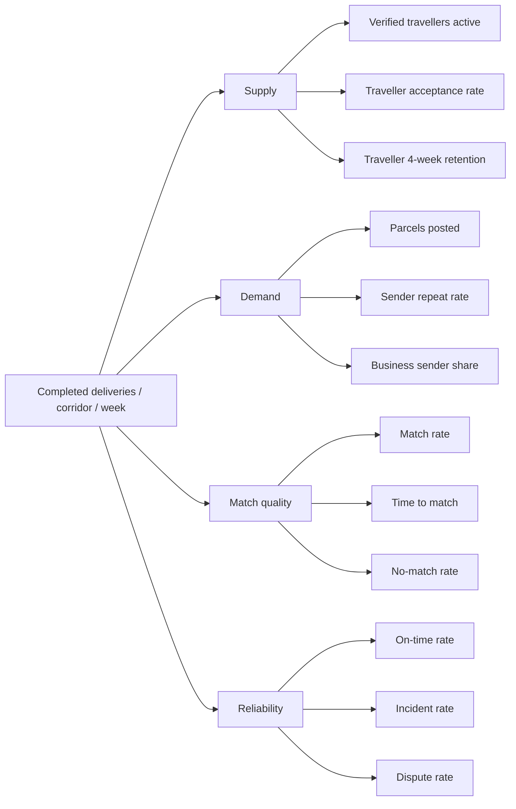

# Analytics & KPIs

**Status:** Draft v0.1 · **Last updated:** 2026-10-24

---

## 1. Principles

1. **Measure the marketplace, not vanity.** GMV is meaningless at pilot scale.
2. **Every metric has an owner and a decision attached.** If nobody would act on a number, do not track it.
3. **No PII in analytics.** Use pseudonymous `user_id`; never phone, name, address, ID number or
   free-text description.
4. **Small numbers are noisy.** With < 100 bookings/week, use weekly aggregates and ranges, not
   percentages to one decimal.

## 2. North-star metric

**Completed deliveries per active corridor per week** — captures supply, demand, matching and trust in
a single number, and cannot be inflated by marketing spend alone.

## 3. Metric tree



## 4. Core KPI definitions

| KPI | Definition | Pilot target | Owner |
|---|---|---|---|
| Match rate | bookings created / parcels posted | ≥ 60% | Product |
| Time to match | median(post → accept) | < 90 min | Product |
| On-time delivery | delivered within agreed window / delivered | ≥ 90% | Ops |
| Incident rate | incidents / completed | < 2% | Trust & Safety |
| Dispute rate | disputes / completed | < 5% | Trust & Safety |
| Cancellation rate (traveller) | traveller cancels / confirmed | < 8% | Ops |
| Sender repeat (6 wk) | senders with ≥ 2 books / senders with ≥ 1 | ≥ 25% | Growth |
| Traveller retention (4 wk) | travellers completing ≥ 2 trips in 28 d | ≥ 30% | Growth |
| Contribution margin | per `docs/PRICING_AND_UNIT_ECONOMICS.md` | > 0 | Founder |
| Verification turnaround | median submit → decision | < 12 h | Ops |
| Support contacts / booking | tickets / completed | < 0.4 | Ops |
| Paid-out accuracy | correct payouts / payouts | 100% | Finance |

## 5. Funnel instrumentation

```
profile_view → signup_started → phone_verified → parcel_draft → quote_shown
→ parcel_posted → match_viewed → booking_requested → traveller_accepted
→ payment_authorised → picked_up → delivered → rated
```

Each step stores `event_name`, `occurred_at`, `user_id` (pseudonymous), `city_pair`, `mode`,
`cohort_week`. **No** free text, no phone, no exact address.

## 6. Route scorecard (weekly)

| Field | Definition |
|---|---|
| Corridor | e.g. `Bareilly→Delhi` |
| Posts | parcels posted |
| Eligible trips | trips passing hard filters |
| Match rate | as above |
| Median price | ₹ |
| Median traveller share | ₹ |
| On-time | % |
| Incidents | count |
| Contribution | ₹ |
| Verdict | `VIABLE` / `WATCH` / `NOT_VIABLE` |

A corridor is **VIABLE** only after ≥ 30 completed bookings with match ≥ 60%, on-time ≥ 90%,
incidents < 2%, contribution > 0. Before that it is `WATCH`. See
`roadmap/PILOT_OPERATIONS_PLAN.md` §5.

## 7. Alerts

| Condition | Severity | Action |
|---|---|---|
| No bookings in 6 h during operating hours | High | Check supply, notify ops |
| Payment webhook failures > 1% | Critical | Page founder |
| Dispute rate > 10% (rolling 20) | High | Pause new bookings on corridor |
| Incident on corridor | Critical | Freeze corridor pending review |
| Traveller cancellation spike | High | Review ranking + outreach |
| Payout attempt failure | Critical | Finance freeze |
| Restore test overdue > 30 days | Medium | Engineering task |

## 8. Data quality checks

- Every event has a `schema_version`.
- Daily job compares `bookings` table against event stream counts; drift > 2% raises a task.
- Financial reports derive **only** from `payment_ledger`, never from analytics.

## 9. Reporting cadence

| Report | Cadence | Audience |
|---|---|---|
| Daily ops digest | Daily | Founders, ops |
| Route scorecard | Weekly | Founders |
| Trust & safety review | Weekly | Founders, T2 |
| Financial reconciliation | Daily + monthly | Finance |
| Pilot go/no-go review | At week 6 and week 10 | Founders, advisor |

## 10. Deliberately not tracked

- Individual user location history.
- Scroll depth, session recordings containing PII.
- Competitor pricing scrapes presented as market truth.
- "App downloads" as a success metric.
