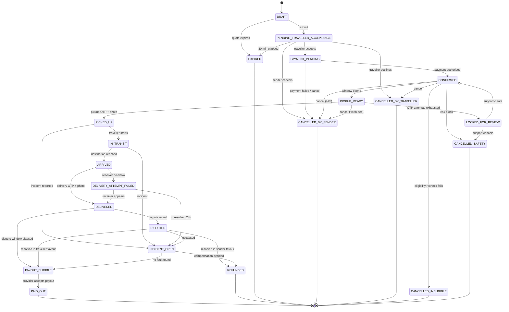
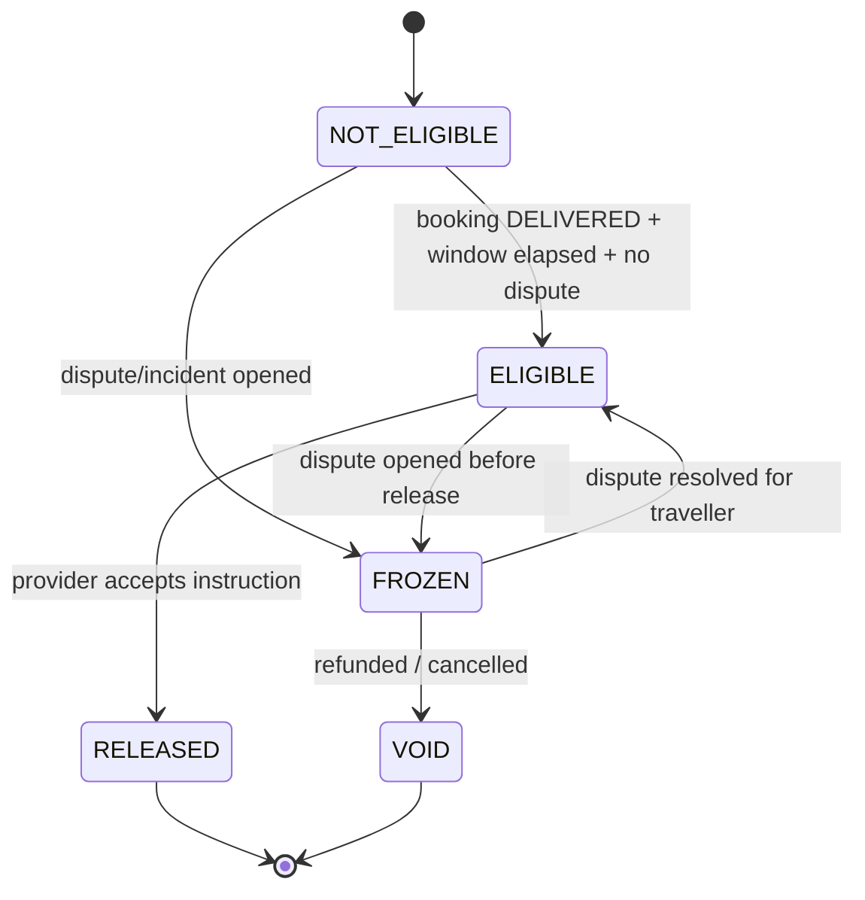

# Booking State Machine

**Status:** Draft v0.1 · **Last updated:** 2026-10-24
**Implementation:** `packages/domain/booking-machine.ts` · **Tests:** `testing/TEST_CASES.md` §Booking

---

## 1. States

| State | Terminal? | Meaning |
|---|---|---|
| `DRAFT` | no | Sender is composing the booking (quote held, not submitted) |
| `PENDING_TRAVELLER_ACCEPTANCE` | no | Request sent; capacity reserved; 30-min clock |
| `PAYMENT_PENDING` | no | Accepted; awaiting payment authorisation |
| `CONFIRMED` | no | Paid/authorised and both sides committed |
| `PICKUP_READY` | no | Within pickup window; OTP issued to sender |
| `PICKED_UP` | no | Custody transferred to traveller (OTP + photo) |
| `IN_TRANSIT` | no | Traveller en route |
| `ARRIVED` | no | Traveller at destination city |
| `DELIVERED` | no* | Receiver OTP + photo captured |
| `PAYOUT_ELIGIBLE` | no | Dispute window elapsed with no dispute |
| `PAID_OUT` | yes | Payout instruction accepted by provider |
| `CANCELLED_BY_SENDER` | yes | — |
| `CANCELLED_BY_TRAVELLER` | yes | — |
| `CANCELLED_INELIGIBLE` | yes | Content/eligibility failure |
| `CANCELLED_SAFETY` | yes | Safety/trust intervention |
| `EXPIRED` | yes | No acceptance in time |
| `DISPUTED` | no | A dispute is open; payout frozen |
| `REFUNDED` | yes | Money returned |
| `LOCKED_FOR_REVIEW` | no | OTP abuse / repeated failure; human only |
| `INCIDENT_OPEN` | no | Loss/damage/safety incident |
| `DELIVERY_ATTEMPT_FAILED` | no | Receiver unavailable |

\* `DELIVERED` is not terminal because it can move to `DISPUTED`, `PAYOUT_ELIGIBLE` or, exceptionally,
be reversed by support to `INCIDENT_OPEN`.

## 2. Diagram

## 3. Transition table (authoritative)

Each transition names the **required actor** and **guard**. The server is the only actor permitted to
write these transitions.

| From | Command | To | Actor | Guards |
|---|---|---|---|---|
| DRAFT | `submit` | PENDING_TRAVELLER_ACCEPTANCE | Sender | quote valid, eligibility pass, capacity reserved |
| DRAFT | `expire` | EXPIRED | System | quote expired |
| PENDING_TRAVELLER_ACCEPTANCE | `accept` | PAYMENT_PENDING | Traveller | before `accept_by`, capacity still held, traveller verified |
| PENDING_TRAVELLER_ACCEPTANCE | `decline` | CANCELLED_BY_TRAVELLER | Traveller | — |
| PENDING_TRAVELLER_ACCEPTANCE | `cancel` | CANCELLED_BY_SENDER | Sender | — |
| PENDING_TRAVELLER_ACCEPTANCE | `auto_expire` | EXPIRED | System | `now() > accept_by` |
| PAYMENT_PENDING | `payment_authorised` | CONFIRMED | System | provider webhook verified, amount matches quote |
| PAYMENT_PENDING | `payment_failed` | CANCELLED_BY_SENDER | System | provider definitive failure |
| PAYMENT_PENDING | `cancel` | CANCELLED_BY_SENDER | Sender | — |
| CONFIRMED | `open_pickup` | PICKUP_READY | System | now within pickup window − 2 h |
| CONFIRMED | `cancel` | CANCELLED_BY_SENDER | Sender | > 2 h before window |
| CONFIRMED | `cancel` | CANCELLED_BY_TRAVELLER | Traveller | no pickup yet |
| CONFIRMED | `eligibility_failed` | CANCELLED_INELIGIBLE | System | eligibility recheck fails |
| CONFIRMED | `safety_block` | CANCELLED_SAFETY | Support | role `trust_safety` |
| PICKUP_READY | `confirm_pickup` | PICKED_UP | Traveller | valid pickup OTP, photo uploaded, before window end + 6 h |
| PICKUP_READY | `cancel` | CANCELLED_BY_SENDER | Sender | ≤ 2 h before window → fee applies |
| PICKUP_READY | `lock` | LOCKED_FOR_REVIEW | System | 5 failed OTP attempts |
| PICKED_UP | `start_transit` | IN_TRANSIT | Traveller | — |
| PICKED_UP | `report_incident` | INCIDENT_OPEN | Sender/Traveller/Support | — |
| IN_TRANSIT | `arrive` | ARRIVED | Traveller | — |
| IN_TRANSIT | `report_incident` | INCIDENT_OPEN | Either | — |
| ARRIVED | `confirm_delivery` | DELIVERED | Traveller | valid delivery OTP, delivery photo |
| ARRIVED | `receiver_unavailable` | DELIVERY_ATTEMPT_FAILED | Traveller | 2 h after arrival |
| DELIVERY_ATTEMPT_FAILED | `confirm_delivery` | DELIVERED | Traveller | valid OTP |
| DELIVERY_ATTEMPT_FAILED | `escalate` | INCIDENT_OPEN | Support | 24 h elapsed |
| DELIVERED | `raise_dispute` | DISPUTED | Sender/Traveller | within 72 h or 7 days of expected delivery |
| DELIVERED | `settle_window` | PAYOUT_ELIGIBLE | System | 72 h elapsed, no dispute |
| DISPUTED | `resolve_sender` | REFUNDED | Support | resolution recorded, refund executed |
| DISPUTED | `resolve_traveller` | PAYOUT_ELIGIBLE | Support | resolution recorded |
| DISPUTED | `escalate` | INCIDENT_OPEN | Support | — |
| INCIDENT_OPEN | `compensate` | REFUNDED | Support + Finance | maker-checker above ₹1,000 |
| INCIDENT_OPEN | `clear` | PAYOUT_ELIGIBLE | Support | — |
| PAYOUT_ELIGIBLE | `release` | PAID_OUT | System/Finance | provider accepted, amount ≤ ledger balance |
| LOCKED_FOR_REVIEW | `clear` | CONFIRMED | Support lead | — |
| LOCKED_FOR_REVIEW | `cancel` | CANCELLED_SAFETY | Support lead | — |

**Any transition not in this table is rejected** with `INVALID_TRANSITION` and logged.

## 4. Payout eligibility (separate machine)

Payout is a **separate** state machine referencing the booking, so a booking can be `DELIVERED` while
payout is `FROZEN`.

## 5. Invariants (must be enforced and tested)

1. A booking's `status` changes only via `applyTransition(command)` with a lock on the row.
2. `DELIVERED` requires a consumed delivery OTP; no support override may set `DELIVERED` directly —
   an override must use `support_assisted_delivery` which records the override as evidence.
3. Payout can never exceed the captured amount minus refunds minus platform fees.
4. A cancelled booking can never return to an active state.
5. `PAID_OUT` and `REFUNDED` are mutually exclusive for a given booking.
6. Every transition writes `booking_events` with `from_state`, `to_state`, `actor`, `reason_code`,
   `occurred_at`, `correlation_id`.

## 6. Timeouts (background jobs)

| Timer | Action |
|---|---|
| 30 min after request | `auto_expire` |
| 15 min after quote | quote invalid |
| 2 h before pickup window | `open_pickup` |
| window end + 6 h | pickup no-show → `CANCELLED_BY_SENDER` + traveller compensation review |
| 2 h after `ARRIVED` | allow `receiver_unavailable` |
| 72 h after `DELIVERED` | `settle_window` |
| 7 days after expected delivery | dispute deadline |
| 24 h `DELIVERY_ATTEMPT_FAILED` | escalate |

Every job must be **idempotent** and safe to run twice.
