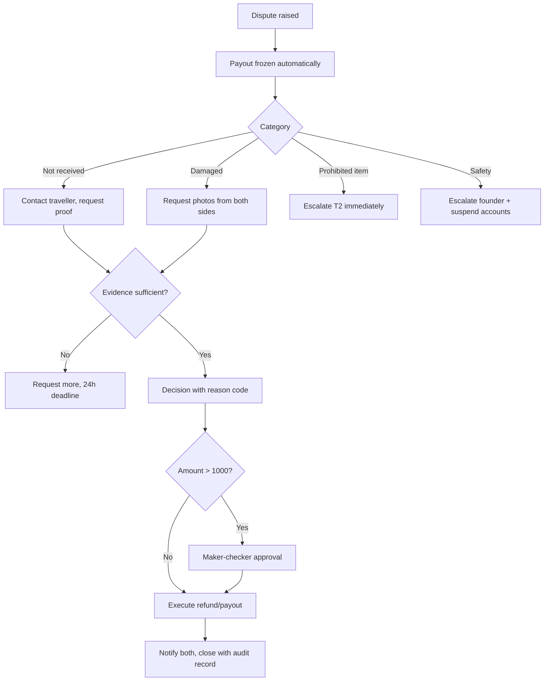

# Operations & Support

**Status:** Draft v0.1 · **Last updated:** 2026-10-24

---

## 1. Operating model for the pilot

Deliberately **manual-first**. The first ~500 bookings are treated as an operations exercise with
software assistance, not as an automated marketplace.

| Function | Pilot staffing | Hours |
|---|---|---|
| Verification review | 1 shared reviewer | 10:00–19:00 IST |
| Booking support / disputes | 1 agent + founder on-call | 08:00–22:00 IST |
| Phone escalation | founder | 24×7 for safety incidents |
| Finance/reconciliation | founder | daily 10:00 |

## 2. Daily operating rhythm

| Time | Task | Owner |
|---|---|---|
| 09:30 | Review overnight incidents, failed payments, stuck bookings | Ops |
| 10:00 | Verification queue cleared to < 12 h age | Reviewer |
| 11:00 | Today's pickups confirmed with senders and travellers | Ops |
| 14:00 | In-transit check; any `DELIVERY_ATTEMPT_FAILED` triaged | Ops |
| 18:00 | Day's deliveries closed; unresolved → incident | Ops |
| 20:00 | Reconciliation: provider ledger vs. platform ledger | Finance |
| Weekly | Route scorecard, incident review, blocked-user review | Founders |

## 3. Support tiers

| Tier | Handles | SLA |
|---|---|---|
| T0 self-serve | FAQ, tracking, receipts, cancellation | instant |
| T1 agent | Booking changes, no-shows, verification queries | first response 2 h |
| T2 trust & safety | Disputes, prohibited items, collusion, threats | first response 4 h, resolution 72 h |
| T3 founder/legal | Police requests, insurer notification, regulator contact | immediate |

## 4. Verification queue SOP

1. Open ID image in evidence viewer (access logged).
2. Check: name consistency with account, image clarity, obvious tampering, expiry.
3. Check selfie liveness match (if vendor provides score, record it; do not eyeball-only).
4. Decide: APPROVE / REJECT (reason code) / REQUEST_MORE.
5. **Never** copy ID numbers into free-text notes. Use structured fields only.
6. Rejections must use catalogue reason codes, not personal remarks.

## 5. Dispute SOP

## 6. Incident classification

| Severity | Example | Response |
|---|---|---|
| S1 Critical | Violence, theft, police involvement, data breach | Immediate founder + legal; freeze accounts; preserve evidence |
| S2 High | Parcel lost, prohibited item found, repeated harassment | 4 h; T2; insurer notified if applicable |
| S3 Medium | Damage, delay > 24 h, mis-declared weight | 24 h; T1 |
| S4 Low | Minor complaint, rating dispute | 72 h; T1 |

## 7. Custody and evidence handling

- A parcel is "in custody" from `PICKED_UP` to `DELIVERED`.
- If custody is unclear, **never** guess: open an incident and record who last confirmed custody.
- Photographs are evidence. Do not delete, crop or "clean" them. Access is logged.
- Physical evidence (the parcel itself) is retained until the dispute is closed + 30 days.

## 8. Prohibited-item discovery procedure

1. Stop the handover or delivery.
2. Do not open sealed packaging further than necessary; photograph as found.
3. Do not confront aggressively; do not handle suspected hazardous material.
4. If the item appears dangerous or illegal → contact local police (100) and record the FIR reference.
5. Suspend both accounts pending review.
6. Notify legal counsel.
7. Preserve chain-of-custody notes.

## 9. Reconciliation (daily)

| Check | Action on mismatch |
|---|---|
| Provider captured = platform ledger captured | Investigate within 24 h |
| Provider refunds = platform refunds | Block payouts until resolved |
| Payout released = expected payout | Freeze finance actions, escalate |
| Duplicate webhook effects | Idempotency test failure → incident |
| Orphan payments (paid, no booking) | Auto-refund path, log |

## 10. Support tooling requirements

- Single booking view: timeline, evidence, payments, messages, flags.
- One-click safe actions with reason codes (not free-text-only).
- Immutable audit of every action.
- Cannot view ID documents without `verification_reviewer` role.
- Cannot release payout without maker-checker above threshold.

## 11. Metrics reviewed weekly

First response time, resolution time, reopen rate, dispute rate, refund rate, verification
turnaround, failed-delivery rate, support cost per booking, top 5 contact reasons.

## 12. Escalation contacts (to be filled before pilot)

| Role | Name | Phone | Backup |
|---|---|---|---|
| Founder on-call | TBD | TBD | TBD |
| Legal counsel | TBD | TBD | — |
| Insurer claims | TBD | TBD | — |
| Payment provider support | TBD | TBD | — |
| Local police station (Bareilly) | TBD | 100 | — |

**A pilot must not start until this table is complete** — see `release/GO_NO_GO_CRITERIA.md`.
