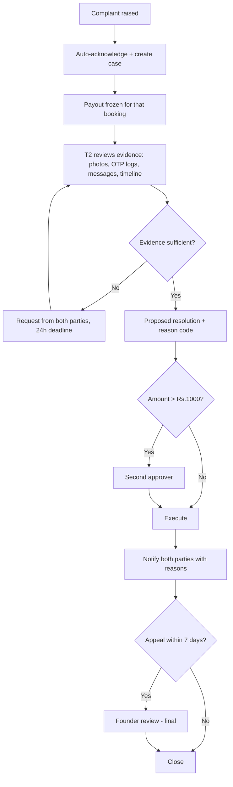

# Grievance & Incident Process — DRAFT

> ⚠️ **DRAFT — NOT LEGAL ADVICE.** Review required, particularly the e-commerce grievance obligations and
> law-enforcement handling.

**Version:** 0.1-draft · **Date:** 2026-10-24

---

## 1. Grievance Officer

| Field | Value |
|---|---|
| Name | **[TO APPOINT]** |
| Designation | Grievance Officer |
| Email | **[grievance@…]** |
| Phone | **[TO APPOINT]** |
| Postal address | **[REGISTERED OFFICE]** |
| Hours | Mon–Sat, 10:00–19:00 IST |

Publication: website footer, app Settings → Help, and every transactional email footer.

## 2. Service levels

| Stage | Target | Escalation |
|---|---|---|
| Automated acknowledgement | immediate | — |
| Human acknowledgement | ≤ 48 hours | Ops lead |
| First substantive response | ≤ 5 business days | Ops lead |
| Resolution | ≤ 30 days | Founder |
| Safety incident first response | ≤ 4 hours | Founder on-call |
| Critical safety (S1) | ≤ 30 minutes | Founder + police if needed |

## 3. Complaint categories and routing

| Category | Route | SLA |
|---|---|---|
| Booking/UX issue | T1 | 2 business days |
| Refund not received | T1 → Finance | 5 business days |
| Parcel delayed | T1 | 24 hours |
| Parcel damaged | T2 | 72 hours |
| Parcel lost | T2 → founder | 72 hours |
| Prohibited item | T2 immediately | 4 hours |
| Harassment/threat | T2 + account suspension | 4 hours |
| Data/privacy request | Privacy contact | 30 days |
| Law-enforcement request | Founder + counsel | immediate |

## 4. Dispute resolution process (customer vs. customer)

## 5. Resolution outcomes

| Code | Meaning | Money effect |
|---|---|---|
| `RESOLVED_DELIVERED_OK` | Parcel delivered as described | Payout released |
| `RESOLVED_REFUND_FULL` | Sender made whole | Full refund, payout void |
| `RESOLVED_REFUND_PARTIAL` | Shared fault | Partial refund |
| `RESOLVED_GOODWILL` | Platform-funded gesture, no fault found | Capped credit |
| `RESOLVED_TRAVELLER_FAULT` | Traveller responsible | Refund + account action |
| `RESOLVED_SENDER_FAULT` | Misdeclaration etc. | Payout released, sender warned |
| `RESOLVED_INCONCLUSIVE` | Evidence insufficient | Payout released, both informed |

**`RESOLVED_INCONCLUSIVE` must be explained to the sender**, not used as a silent default against them.

## 6. Incident response — safety

### 6.1 S1 — Critical (violence, theft, police, data breach)
1. Ensure immediate human safety; advise calling **100/112**.
2. Founder on-call engages within 30 minutes.
3. Freeze involved accounts and payouts.
4. Preserve all evidence; do not delete messages or photos.
5. Notify counsel.
6. Cooperate with police; record FIR/acknowledgement number.
7. Written incident report within 24 h.

### 6.2 S2 — High (lost parcel, prohibited item, harassment)
1. T2 within 4 hours.
2. Freeze payout for the booking.
3. Gather evidence from both parties.
4. Suspend accounts if a pattern or credible threat exists.
5. Report prohibited/illegal contents to police where required.

### 6.3 S3/S4
Standard dispute flow with 24 h / 72 h targets.

## 7. Law-enforcement requests

| Step | Requirement |
|---|---|
| 1 | Verify requester identity and authority (written request, official email/ID) |
| 2 | Log the request (who, what, when, legal basis cited) |
| 3 | Notify counsel before producing data where legally permitted |
| 4 | Produce only the minimum data specified |
| 5 | Record what was produced and to whom |
| 6 | Do not notify the user if legally prohibited; otherwise notify unless it endangers someone |

## 8. Records

- Every case: `case_id`, category, parties (pseudonymous), evidence links, decisions, reason codes,
  approver, timestamps.
- Case records retained 3 years (verify against limitation periods).
- Monthly report to founders: volume by category, SLA compliance, outcomes, repeat offenders.

## 9. Appeals

A user may appeal a resolution within 7 days. Appeal is reviewed by someone who did not make the original
decision. The appeal decision is final within the platform, without prejudice to statutory rights.

## 10. Transparency

We will publish (quarterly, from pilot): number of grievances, median resolution time, % resolved within
30 days, and category breakdown. Publishing our own failure rate is a trust commitment.

## 11. Legal review points

- [ ] Are the appointed-officer publication requirements met for an e-commerce entity?
- [ ] Is the 30-day resolution target consistent with applicable rules?
- [ ] Does the appeal process conflict with consumer-forum rights?
- [ ] Data-minimisation of case records vs. evidence-retention needs.
