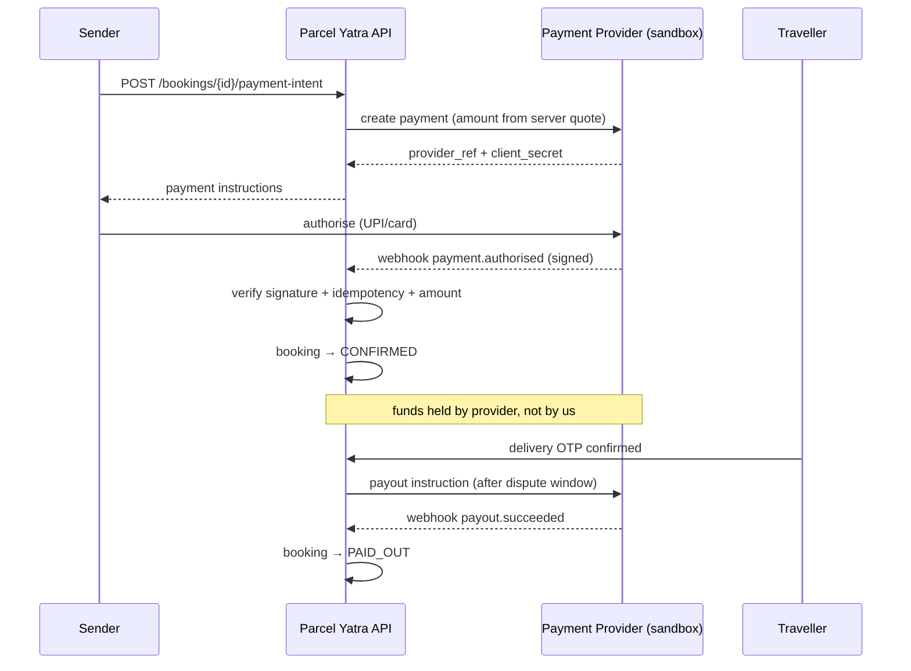

# Payments, Tax & Settlement

**Status:** Research + design draft — **NOT LEGAL OR TAX ADVICE** · **Date:** 2026-10-24
**Hard rule:** no real money moves until GATE-3 (payment provider) and GATE-4 (tax) are cleared in writing.

---

## 1. The fund-flow question, stated honestly

The desired product behaviour is: *sender pays → money is held → traveller is paid after delivery
confirmation*. That behaviour **sounds like escrow** and may be a regulated activity if Parcel Yatra
itself holds or controls the funds.

We therefore distinguish three architectures:

| Model | Who holds funds | Our position |
|---|---|---|
| **A. Provider-managed delayed payout** | Licensed provider holds; we instruct release | **Preferred** — only viable path |
| **B. Platform-held funds (our account)** | Parcel Yatra | **Rejected** — potential unauthorised payment/escrow activity |
| **C. Wallet / stored value** | Parcel Yatra or partner | **Rejected** — PPI licensing regime |

Only Model A is in scope. Even Model A requires **written confirmation** from the provider that:
- marketplace onboarding is permitted for this business category;
- delayed payout to a private individual (the traveller) is a supported product;
- refunds/partial refunds are supported via API;
- the provider's KYC requirements are compatible with our traveller verification.

## 2. Provider selection criteria

| Criterion | Why |
|---|---|
| Marketplace / route or split settlement support | Core need |
| Delayed payout or hold-and-release product | Core need |
| Refund + partial refund APIs | Cancellations, disputes |
| Webhook reliability + signature scheme | Integrity |
| UPI + cards + netbanking | Indian users |
| Sub-merchant / linked-account KYC | Travellers as payees |
| Sandbox with realistic states | We build against sandbox first |
| Published settlement timelines | Reconcilability |
| India data residency | DPDP planning |

**Not verified:** whether any specific provider offers all of these for this model. This is a
conversation, not an assumption.

## 3. Payment flow (sandbox design)



## 4. Non-negotiable payment engineering rules

1. **Server-side amount.** Client can never specify amount.
2. **Webhook signature verification** with provider secret; reject unsigned.
3. **Replay protection:** store `provider_event_id`; duplicate = no-op 200.
4. **Timestamp tolerance** (e.g. ±5 min) to limit replay.
5. **Idempotency keys** on all mutating calls to provider.
6. **Unknown state ≠ failure.** Timeout → `PAYMENT_PENDING` + poll provider; never double-capture.
7. **Append-only ledger** — `payment_ledger` has no UPDATE/DELETE grants.
8. **Reconciliation job** daily: provider statement vs. ledger.
9. **No card data touches our servers** (hosted fields / redirect flow).
10. **Refund requires reason code** and, above threshold, a second approver.

## 5. Refund & chargeback handling

| Case | Behaviour |
|---|---|
| Cancel before capture | Void authorisation |
| Cancel after capture, before pickup | Full/partial refund per policy |
| Dispute resolved for sender | Refund, payout VOID |
| Chargeback raised | Freeze payout; respond with evidence bundle within network deadline |
| Provider fee on refund | Absorbed by platform (decide explicitly; currently assumed absorbed) |
| Partial refund | Supported; ledger records both legs |

## 6. Tax considerations (all L5 — require a tax professional)

| Issue | Question |
|---|---|
| GST on platform fee | Is the facilitation service a separate supply? At what rate? |
| GST on transport of goods | Does the traveller's carriage constitute a taxable service? Is the traveller registered? |
| Who invoices the sender | Parcel Yatra (facilitation) + traveller (transport)? Two invoices? |
| Marketplace collection model | Does GST have to be collected by the operator on behalf of suppliers? |
| TDS/TCS on payouts | Thresholds and applicability to individual travellers |
| Threshold for traveller GST registration | Aggregate turnover implications |
| Invoice for a private individual traveller | Is an invoice legally required / practically possible? |
| E-invoicing | Applicability at our scale |

**We explicitly do not state a GST rate or treatment as settled.** The 18% figure in
`docs/PRICING_AND_UNIT_ECONOMICS.md` is a modelling placeholder.

## 7. Accounting & audit

- Double-entry style ledger: `payment_ledger` (immutable) + `settlement_batch`.
- Every booking has: quote → payment intent → capture → (refund) → payout, each with provider refs.
- Monthly close: provider statement, bank statement, ledger must reconcile to the paisa.
- Auditor access: read-only export of ledger + audit log.

## 8. Anti-money-laundering & fraud (practical, not legal advice)

| Risk | Control |
|---|---|
| Structuring many small payouts | Velocity limits per traveller/day |
| Mule accounts | Payout name must match KYC name; bank account change requires re-verification |
| Refund abuse | Refund only to original instrument |
| Collusive fake deliveries | Same-device / same-IP / repeated-pair detection |
| Sanctions/PEP | Provider screening; we rely on provider KYC + our blocklist |

## 9. Pilot configuration

```env
PAYMENTS_MODE=sandbox
PAYMENTS_LIVE=false
PAYOUTS_ENABLED=false
PROVIDER=mock
```

Production toggles must be **deployment-controlled**, not user-accessible, and changing them requires a
release approval (`release/RELEASE_CHECKLIST.md`).

## 10. Launch gates

| Gate | Requirement |
|---|---|
| GATE-3 | Provider written confirmation: marketplace permitted, delayed payout supported, refunds supported |
| GATE-3b | Provider sandbox integration tested end-to-end incl. failure and replay |
| GATE-4 | Tax opinion: invoicing, GST, TDS/TCS |
| GATE-4b | Ledger + reconciliation tested against sandbox statements |
| GATE-5 | Insurance/liability position documented (separate gate) |

## 11. What we will never build

- A wallet, stored-value balance, or "Parcel Yatra credits" redeemable for cash.
- Holding sender money in our own bank account.
- Paying travellers in cash collected by other travellers (COD).
- Manual "adjustments" to the ledger without an auditable transaction.
