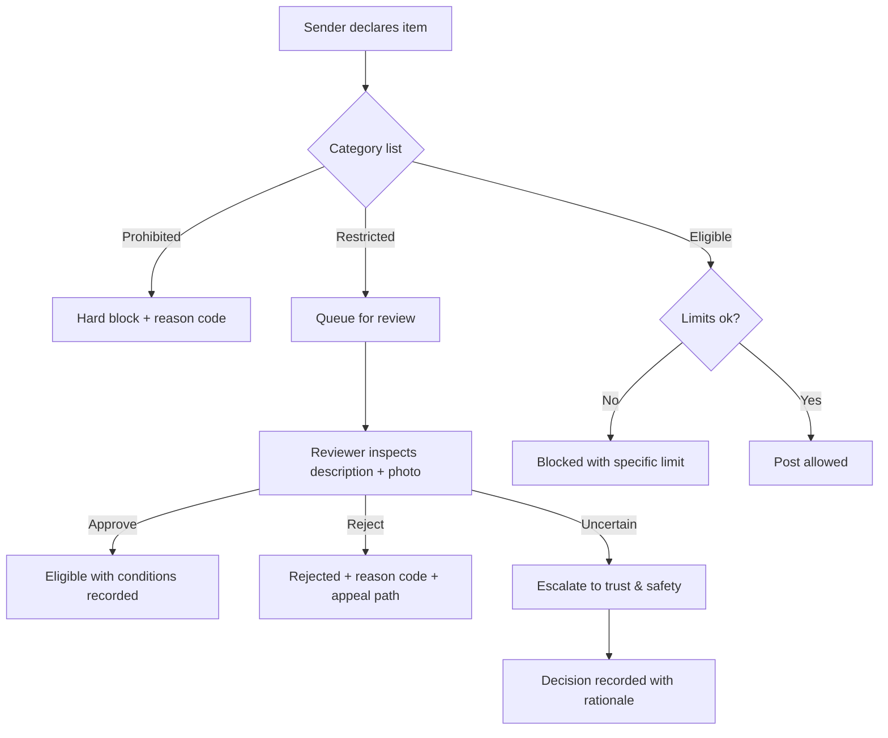

# Prohibited & Restricted Goods Policy

**Status:** Draft for legal review · **Effective:** not yet · **Date:** 2026-10-24
**Applies to:** all senders, travellers and receivers on Parcel Yatra.

> This list is **risk-based and deliberately conservative**. It is not a statutory schedule. Indian law
> restricts many categories across multiple statutes; a lawyer must review this list before launch.

---

## 1. Definitions

- **PROHIBITED** — never accepted, no exceptions, no manual override.
- **RESTRICTED** — not accepted by default; may be accepted only with documented human approval under §5.
- **ELIGIBLE** — acceptable within pilot limits.

## 2. Pilot hard limits

| Limit | Value | Rationale |
|---|---|---|
| Max weight | 5 kg | Fits traveller capacity; limits value density |
| Max longest side | 45 cm | Practical for a car boot/seat |
| Max declared value | ₹5,000 | **No insurance cover confirmed** |
| Parcels per booking | 1 | Simplicity, screening quality |
| Parcels per traveller per month | 4 | Avoid commercial-carrier appearance |
| Packaging | Sealed, tamper-evident | Evidence integrity |

## 3. PROHIBITED (hard block, no override)

### 3.1 Illegal or regulated substances
- Narcotics, psychotropic substances, controlled drugs (NDPS-framed items)
- Firearms, ammunition, parts, accessories
- Explosives, fireworks, flares, gunpowder, detonators, airbag inflators
- Blasting agents, industrial explosives
- Poisons, toxic substances, pesticides in concentrate form
- Radioactive material
- Biological/infectious material, diagnostic specimens, hazardous or bio-medical waste
- Human or animal remains, organs, blood, tissues
- Wildlife products, ivory, animal parts (Wildlife Protection Act–framed items)

### 3.2 Financial & identity instruments
- Cash, banknotes, coins (as collectibles or currency)
- Jewellery, gold, silver, platinum, gems, precious stones, bullion
- Bearer securities, traveller's cheques, demand drafts, promissory notes
- Credit/debit/ATM cards, SIM cards in bulk
- **Passports** and other travel/identity documents (high-value, high-liability)
- Titles/deeds, share certificates, negotiable instruments
- Lottery tickets, betting/gambling devices

### 3.3 Dangerous goods
- Flammable liquids and gases, fuel, oil, grease, paint, thinners, adhesives, solvents
- Corrosives, acids, alkalis, mercury
- Compressed gas cylinders, fire extinguishers
- Lithium batteries **loose or damaged**; power banks; e-bike batteries; car batteries
- Magnets strong enough to affect transport safety
- Dry ice
- Any item requiring temperature control

### 3.4 High-theft items (pilot exclusion)
- Mobile phones, laptops, tablets, smartwatches, cameras, drones
- TVs, monitors, LCD/OLED/plasma panels
- Gaming consoles, audio equipment above ₹5,000
- Branded luxury goods, watches above ₹5,000
- Antiques, art, collectibles

### 3.5 Living things & perishables
- Live animals, birds, insects, livestock, pets
- Plants requiring phytosanitary clearance
- Perishable food requiring cold chain
- Alcohol, tobacco, e-cigarettes/vapes
- Medicines, vaccines, medical devices (pilot exclusion)

### 3.6 Content
- Pornographic or obscene material
- Counterfeit goods, pirated media
- Material inciting violence or communal hatred
- Any item unlawful to possess, transport or sell in India

## 4. RESTRICTED (human approval required — default reject)

| Category | Why restricted | Approval conditions |
|---|---|---|
| Legal documents (property papers, court papers, marksheets) | Irreplaceable; fraud risk | Sender ID + declared value ≤ ₹5,000 + tamper-evident packaging + photographed seal; copy of document **not** uploaded |
| Bank/company cheques | Negotiable value | **Reject at pilot.** Requires bank-level verification we cannot do. |
| Educational certificates | Fraud/duplication | As legal documents; receiver signature + photo |
| Sample goods for business | Content ambiguity | Description + invoice copy (no PII beyond business) + human review |
| Spare parts (oil-free, battery-free) | Residue risk | Declaration of no fuel/oil/battery; photo |
| Cosmetics (sealed, non-flammable) | Chemical content | Sealed retail pack, no aerosols, human review |
| Printed material in bulk | Content screening | Sample pages reviewed |
| Religious items | Sentimental value | Declared value cap; no precious metal |
| Keys | Security risk | Sender accepts risk; no address attached to keys |
| SIM-free electronics accessories (cables, chargers) | Low value | Declared value ≤ ₹1,000 |

## 5. Human review procedure

**Reviewer must never approve based on a verbal assurance.** If classification is uncertain, the answer
is **reject**, not "probably fine".

## 6. Sender declaration (mandatory, stored)

> I declare that the contents of this parcel are accurately described, are not prohibited or restricted
> under this policy or Indian law, are lawfully owned or entrusted to me, and are packaged to withstand
> normal handling. I understand Parcel Yatra may refuse carriage, open the parcel in my presence, or
> report unlawful contents to authorities.

Accepted with timestamp, IP, device and version of policy.

## 7. Traveller rights at handover

A traveller may **always** refuse a parcel without penalty if:
- the packaging is damaged or obviously resealed;
- the declared weight is materially exceeded;
- the parcel appears to contain a prohibited item;
- the sender cannot show the booking record.

Refusal code: `HANDOVER_REFUSED_*` with a reason. No penalty, no rating impact.

## 8. Discovery of a prohibited item

Follow `docs/OPERATIONS_AND_SUPPORT.md` §8. Summary: stop, do not handle hazards, photograph, escalate,
suspend accounts, contact police where illegal, notify counsel, preserve chain of custody.

## 9. Consequences

| Offence | First | Second | Serious (weapons/drugs/explosives) |
|---|---|---|---|
| Misdeclaration (non-dangerous) | Warning + cancellation | Suspension 30 days | — |
| Prohibited item attempt | Cancellation + 90-day suspension | Permanent ban | — |
| Dangerous/illegal goods | Permanent ban + police report | — | Immediate ban + report |

## 10. Operational checklist (print for pilot desk)

- [ ] Category is on the eligible list
- [ ] Weight ≤ 5 kg, longest side ≤ 45 cm
- [ ] Declared value ≤ ₹5,000
- [ ] Description is specific (not "gift", "stuff", "documents" alone)
- [ ] Photo of sealed parcel uploaded
- [ ] Declaration accepted
- [ ] If restricted: reviewer decision recorded with ID
- [ ] If any doubt: **reject and escalate**

## 11. Legal review required

This policy must be reviewed against: NDPS Act, Arms Act, Explosives Act, Drugs & Cosmetics Act,
Wildlife Protection Act, Customs Act, BNS provisions on unlawful transport, and any mode-specific goods
rules. **Not verified in this pass.**
