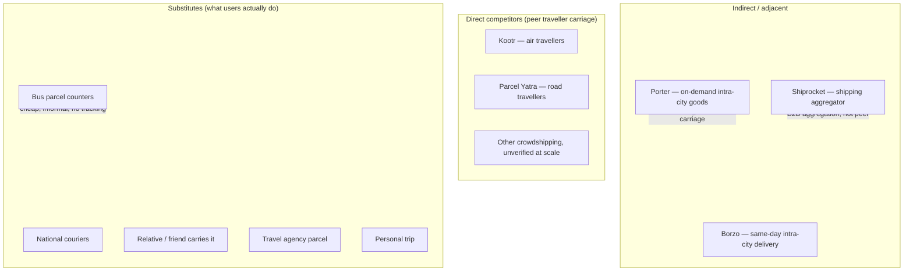

# Competitor Landscape

**Status:** Draft v0.1 · **Research date:** 2026-10-24 · **Method:** REA public-page observation + public sources
**Rule:** labels are mandatory. `OBSERVED` = seen on the page today. `PUBLISHED` = the company says so.
`INFERRED` = our reasoning. `UNKNOWN` = we could not verify.

---

## 1. Category map

## 2. Porter — **indirect competitor / benchmark**

**URL:** https://porter.in/ · **Accessed:** 2026-10-24 · **Evidence:** E-02, E-03, E-04, E-07, E-08

| Dimension | Finding | Label |
|---|---|---|
| Model | On-demand goods transport marketplace; app-based booking of 2W/trucks; also Enterprise + API | OBSERVED |
| Target | Intra-city business and consumer goods movement; "Porter Enterprise" for businesses | OBSERVED |
| Service tiers | Two-Wheeler up to **20 kg**; Trucks up to **2500 kg**; Packers & Movers; API | OBSERVED |
| Geography | 22 Indian cities per their FAQ; site lists Delhi NCR, Lucknow, Kanpur, Jaipur etc.; also UAE, Turkey, Malaysia | OBSERVED + PUBLISHED |
| Pricing | Per-km + vehicle type; estimate via site/app | OBSERVED (mechanism only) |
| Actual prices | **Not captured** — requires location input | **UNKNOWN** |
| Sender onboarding | App download, phone auth (INFERRED from app-first UX) | INFERRED |
| Driver onboarding | "Driver Partners" language; partner signup implied | PUBLISHED |
| Verification | Not publicly documented on homepage | UNKNOWN |
| Prohibited items | Detailed public list: passports, currency, jewellery, expensive electronics, medicines, batteries, fragile/LCD items, livestock, "sensitive documents", hazardous/bio-medical waste | OBSERVED (E-04) |
| Tracking | Not observed in this pass | UNKNOWN |
| Insurance/claims | "Insurance FAQs" link exists; terms not read | UNKNOWN |
| Scale claims | 3 countries, 15 lakh+ driver partners, 1 crore+ customers, 10 crore+ trips | PUBLISHED (self-claimed, unverified) |
| Regulatory notes | "Zero Tolerance Policy" page exists | OBSERVED |

**Why it is not a direct competitor:** Porter's public proposition is **on-demand intra-city** goods
movement with a professional driver; it does not present peer travellers carrying parcels along a
planned inter-city journey. Carrying a parcel Bareilly→Delhi is outside its stated service.

**Why it matters anyway:** it sets the price anchor for "someone picks up my parcel" in UP, and its
prohibited-goods list is a useful, publicly published industry reference — but **it is Porter's policy,
not Indian law**, and we must not copy it verbatim.

## 3. Kootr — **direct competitor (air mode)**

**URL:** https://www.kootr.com/ · **Accessed:** 2026-10-24 · **Evidence:** E-05, E-06

| Dimension | Finding | Label |
|---|---|---|
| Model | Peer-to-peer delivery via **verified air travellers**; "social networking app for inter-city deliveries" | OBSERVED |
| Entity | Kootr Ventures (OPC) Private Limited, Indore, MP | OBSERVED |
| Surfaces | iOS App Store + Google Play listings | OBSERVED |
| Handover | "PIN-verified handover" (4-digit PIN per FAQ section titles) | OBSERVED |
| Traveller pitch | "Travel & Earn", "Offset your flight costs" | OBSERVED |
| Sender pitch | "Send Items", "Find verified travelers" | OBSERVED |
| Green angle | "Reduce carbon footprint" | OBSERVED |
| Geography | India-wide claim ("India's 1st…"), no city list observed | OBSERVED / UNKNOWN detail |
| Pricing | Not visible without app; no public rates | **UNKNOWN** |
| Verification method | "Verified travelers" claimed; mechanism not published | **UNKNOWN** |
| Prohibited items | FAQ section exists; answers client-rendered, not captured | **UNKNOWN** |
| Liability/insurance | Not published on landing/FAQ index | **UNKNOWN** |
| Legal status of air-carriage model | Not published | **UNKNOWN** |
| Traffic/scale | No public numbers | **UNKNOWN** |

**Assessment:** Kootr validates that *someone* believes in India peer traveller carriage and has built a
product. It is the closest direct analogue, but on **air** mode, which we have deliberately excluded as
legally gated. Its existence is evidence of concept intent, **not** evidence of demand, safety, or
profitability — none of which we can verify.

## 4. Borzo — **indirect competitor**

| Dimension | Finding | Label |
|---|---|---|
| Model | On-demand same-day intra-city delivery | INFERRED from category position; not re-verified this pass |
| Relevance | Price anchor for urgent small parcels within a city | INFERRED |
| Pricing | **Not captured** | UNKNOWN |

Marked as needing verification before any external comparison (see `research/SOURCE_REGISTER.md`).

## 5. Shiprocket — **infrastructure / adjacent**

Aggregator for e-commerce shipping (courier selection, labels, pickup). Not a peer marketplace, but a
**potential fallback partner** for our "fallback to conventional courier" differentiator. Commercial and
API terms not researched → **UNKNOWN**.

## 6. Substitutes — the real competition

| Substitute | Why users choose it | Weakness we can attack |
|---|---|---|
| Bus parcel counter | Cheapest, familiar, "goes tonight" | No tracking, no proof, counter hours, no accountability |
| National courier | Brand trust, tracking | 24–72 h, hub routing, not same-day |
| Relative/friend | Free, trusted | Requires knowing someone travelling |
| Travel agency parcel | Local trust | Informal, no digital proof |
| Going yourself | Certainty | Costs a day and a fare |

**Key insight (INFERRED):** our true competitor is the **bus parcel counter**, not Porter or Kootr. That
sets a brutally low price anchor and a high convenience bar.

## 7. What we could not determine

- Any competitor's take rate, GMV, order volume, or unit economics.
- Any competitor's claim verification method or dispute outcomes.
- Whether any Indian road-based peer crowdshipping service operates at meaningful scale.
- International analogues (e.g. crowdshipping startups) were **not** researched in this pass; treat as
  an open research task rather than a conclusion.

## 8. Implication for Parcel Yatra

There is **no verified evidence of a scaled Indian road-based peer parcel marketplace**. That is either
an opportunity or a warning. The pilot's job is to find out which — cheaply, with 20 interviews and 300
bookings, not with a large build.
