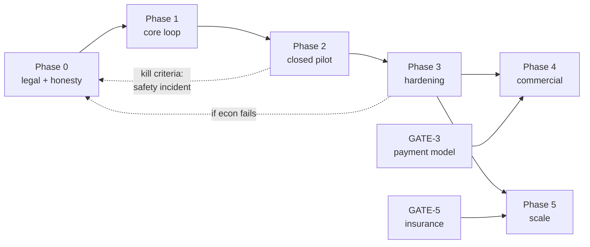

# Roadmap Phases

**Status:** Draft v0.1 · **Date:** 2026-10-24
Sequenced by **what must be true before the next thing is worth building**, not by what is fun to build.

---

## 1. The sequencing logic

```
Can we describe the product honestly?        → Phase 0
Can we build the booking transaction safely? → Phase 1
Can two real people complete a handover?     → Phase 2
Can we operate it without hurting anyone?    → Phase 3
Can we take money legally?                   → Phase 4 (gated, may never open)
Can it grow without breaking?                → Phase 5
```

Each phase has an **exit test**: a statement that is either true or false. A phase that "feels done" is
not done.

Durations are **estimates for a 2–4 person team** and are labelled as such. They are not commitments
and they assume no legal gate is the critical path — which, for Phase 4, it usually is.

---

## 2. Phase overview

| Phase | Name | Duration (est.) | Exit test | Real money? |
|---|---|---|---|---|
| 0 | Foundation & honesty | 2–3 weeks | A stranger understands the product and what it refuses | No |
| 1 | Core booking loop | 6–8 weeks | One booking completes end-to-end on staging with mock payment | No |
| 2 | Closed pilot | 4–6 weeks | 20 real parcels delivered across Bareilly⇄Delhi with zero unresolved safety incidents | No |
| 3 | Operational hardening | 4–6 weeks | Support, disputes and reconciliation run for 14 days without founder heroics | No |
| 4 | Commercial enablement | **Gated** | GATE-1/2/3/4/6 cleared in writing | Yes |
| 5 | Scale | Post-PMF | Second corridor cluster works without new code | Yes |

---

## 3. Phase 0 — Foundation & honesty (2–3 weeks)

**Goal:** remove the ways this product could lie to its users before writing code that could.

| Work | Output |
|---|---|
| Legal position on private-car goods carriage | Written note; determines whether Phase 1 is even viable |
| Prohibited/restricted item policy | Final list, published, enforced server-side later |
| Pricing model | Formula with a worked example; all numbers labelled hypothesis |
| Copy system | High-stakes strings drafted in EN + HI |
| Design tokens + one flow wireframed | Landing + send wizard |
| Repo, CI skeleton, IaC skeleton | `main` protected, lint/test/build running |
| Entity + GST status | Decided, because it changes the payment model |

**Exit test:** five people outside the team read the landing page and can correctly answer "what do we
carry, what do we refuse, what happens if it is lost". Four of five must be right.

**Kill criteria:** if counsel says private-car parcel carriage for strangers requires a transport
licence we do not have, Phase 1 stops and the model is redesigned. Finding this in week 2 is a
bargain; finding it in week 20 is not.

---

## 4. Phase 1 — Core booking loop (6–8 weeks)

**Goal:** the smallest system that can move one parcel safely from posted to delivered, with no money.

| Epic | Key deliverables |
|---|---|
| E1 Auth | Phone OTP, sessions, refresh rotation, rate limits |
| E2 Verification | Upload, queue, admin decision, audit |
| E3 Parcels | Create, eligibility E1–E10, quote, match list |
| E4 Trips | Publish, capacity, mode flags |
| E5 Bookings | State machine, transitions API, idempotency, concurrency |
| E6 Handover | OTP issue/verify/consume, photos, lockout |
| E7 Mock payments | Intent, capture simulation, refund simulation |
| E8 Admin v0 | Verification queue, booking search, audit log |
| E9 Observability | Logs, metrics, alerts that have fired once |

**Explicitly not in Phase 1:** real payments, payouts, disputes workflow (only "open a case" with
manual handling), ratings, Hindi completeness, iOS, dark mode.

**Exit test:** `TC-CRIT-01`…`TC-CRIT-10` all pass on staging, and one booking goes from posted to
delivered in a scripted run that a second person can reproduce from the README.

**Risk:** the state machine is where scope explodes. Resist adding states. Every state needs a
transition, a UI, a test, a notification and a support script.

---

## 5. Phase 2 — Closed pilot (4–6 weeks)

**Goal:** 20 real parcels, real people, two corridors, no real money.

| Work | Detail |
|---|---|
| Recruitment | 20–30 senders, 10–15 travellers, all known to someone on the team |
| Corridors | Bareilly⇄Delhi NCR, Bareilly⇄Lucknow only |
| Item scope | Documents + ≤ 5 kg / ≤ ₹5,000 goods |
| Support | Founder answers the phone; this is a feature, not a compromise |
| Observation | Watch at least 10 sessions in person; do not help unless they are stuck for > 2 min |
| Instrumentation | Funnel events, time-to-complete, failure reasons |
| Incident drill | One lost-parcel tabletop before the first real parcel |

**Exit test:** 20 parcels delivered; zero unresolved safety incidents; ≥ 80% of senders say they would
use it again; the founder can explain every failure that happened.

**What "success" does not mean:** 20 parcels proves the flow works, not that there is a market. Say
that explicitly in any investor or internal update.

---

## 6. Phase 3 — Operational hardening (4–6 weeks)

**Goal:** the product runs for two weeks without the founder personally rescuing it.

| Work | Detail |
|---|---|
| Support tooling | Real queue, macros, SLA timers, escalation |
| Disputes | Full workflow with evidence, outcomes, approvals, appeals |
| Reconciliation | Daily provider-vs-ledger, mismatch classes, blocking rule |
| Grievance | Published officer, response tracking, statutory window |
| Hindi | Full parity, reviewed by a native speaker (not machine translation) |
| Accessibility | TalkBack end-to-end, 200% zoom, contrast audit |
| Security | External penetration test, High findings fixed |
| Load | 3× current peak, capacity-race correctness under load |
| Runbooks | Every alert has a runbook; every runbook has been used once |

**Exit test:** 14 consecutive days where no incident required the founder to write code or SQL
directly. Support handled it with the tools.

**This is the phase most startups skip**, and it is the one that determines whether growth is
survivable.

---

## 7. Phase 4 — Commercial enablement (gated)

**This phase may never open.** It opens only when the legal gates close, and the gates are not in
engineering's control.

| Gate | What must be in writing |
|---|---|
| GATE-1 | Entity + GST status appropriate to the chosen fund-flow model |
| GATE-2 | Terms, privacy, refund policy reviewed by Indian counsel |
| GATE-3 | Payment provider confirms the model is permitted (or a licence is obtained) |
| GATE-4 | Transport position confirmed for the actual operation |
| GATE-5 | Insurance in force **or** permanent exclusion in all copy |
| GATE-6 | Grievance officer live with the statutory window |

| Engineering work (only after gates) | Detail |
|---|---|
| Real payment adapter | Provider SDK, webhooks, reconciliation |
| Payouts | KYC for travellers, bank transfer, failure handling |
| Invoicing | GST invoices, credit notes |
| Chargebacks | Provider process, evidence pack |
| Finance controls | Two-person approval, daily close, audit trail |
| Reconciliation at volume | Automated matching, exception queue |

**Exit test:** 30 days of sandbox reconciliation with zero unexplained breaks, plus every gate
document on file.

**Do not** start this phase's engineering before GATE-3. Building a payment integration for a model
that is not permitted is the most expensive way to learn that it is not permitted.

---

## 8. Phase 5 — Scale (post-PMF)

Only after the pilot shows retention and a positive contribution margin (or a funded path to it).

| Work | Trigger |
|---|---|
| Third and fourth corridors | Two corridors consistently > 70% match rate |
| Bus/train modes | Written operator/legal clearance per mode |
| iOS | Android retention proven |
| Fraud ML | > 500 bookings/day or measurable fraud loss |
| Multi-region | Single-region latency or availability becomes the binding constraint |
| Business accounts | Repeated B2B demand with a signed letter of intent |
| Insurance product | Insurer partnership, not a marketing claim |

**Rule:** no item in Phase 5 starts because a competitor has it. Start because a measured constraint
demands it.

---

## 9. What is deliberately never on this roadmap

| Not planned | Why |
|---|---|
| In-app wallet | Regulated; we do not want to be a payment instrument |
| Live GPS tracking | Privacy cost exceeds the value at this price point |
| Cash on delivery | Cash handling is an entirely different business |
| Same-day intra-city delivery | That is Porter's market; we would lose |
| Employing travellers | Changes the legal nature of the entire business |
| Cross-border | Customs, entirely different compliance surface |
| A "super app" | Focus is the only advantage a small team has |

---

## 10. Dependency graph (what blocks what)



The dotted lines matter: a serious safety incident sends you back to Phase 0, and no amount of
engineering momentum should prevent that.

---

## 11. Honest scheduling note

The engineering estimates above assume the legal gates run in parallel. In practice:

- GATE-3 (payment model) commonly takes **2–4 months** of back-and-forth with a provider.
- GATE-5 (insurance) can take **longer** and may not be available at all for peer-to-peer carriage of
  documents.
- These are the real critical path. Engineering can be finished and waiting.

Plan the business around the gates, not around the code. A working product with no legal path to
revenue is a hobby with good architecture.
