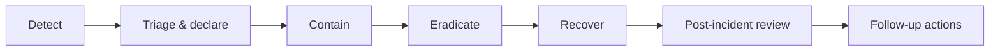

# Incident Response Plan

**Status:** Draft v0.1 · **Date:** 2026-10-24
**Scope:** security incidents, data breaches, fraud events, safety incidents, and major outages.

---

## 1. Severity levels

| Level | Definition | Response time | Who |
|---|---|---|---|
| **SEV-1** | Data breach with personal data; ID documents exposed; full outage; active safety threat | 15 min | Founder + on-call engineer + counsel |
| **SEV-2** | Unauthorized access to one user's data; payment integrity issue; partial outage | 1 h | On-call engineer + founder |
| **SEV-3** | Suspicious activity contained; single-feature degradation | 4 h | On-call |
| **SEV-4** | Minor issue, no data/money impact | Next business day | Owner |

## 2. Roles

| Role | Responsibility |
|---|---|
| Incident Commander (IC) | Owns the incident, decisions, comms cadence. Default: founder |
| Technical Lead | Investigates and fixes |
| Comms Lead | User/regulator communication drafts |
| Scribe | Timeline, decisions, evidence preservation |

For a 2-person team these roles are shared; **the IC must still be explicitly named** at declaration.

## 3. Lifecycle



### 3.1 Detect
Sources: alerting, user report, provider notification, staff observation, dependency advisory.

### 3.2 Triage & declare
- Assign SEV level.
- Open incident channel + timeline doc.
- Name IC.
- **Preserve evidence before fixing** (snapshot logs, DB state, disk images if needed).

### 3.3 Contain
| Scenario | Containment |
|---|---|
| Credential leak | Rotate secrets, revoke sessions, force re-auth |
| ID document exposure | Revoke signed URLs, rotate bucket credentials, disable affected endpoint |
| Payment fraud | Freeze payouts, disable payout job, notify provider |
| Account takeover wave | Force logout all, raise OTP friction |
| Dependency compromise | Pin/rollback, block egress, rebuild |
| Active safety threat | Suspend accounts, advise police (100/112) |

### 3.4 Eradicate
Remove the root cause; patch; verify no persistence (new admin users, changed webhooks, altered config).

### 3.5 Recover
Restore service, verify data integrity (row counts, ledger sums), monitor for 24 h.

### 3.6 Post-incident review (within 5 business days)
Blameless. Outputs: timeline, root cause, impact, what worked, actions with owners and dates.

## 4. Data breach playbook (DPDP-oriented)

> Timelines below must be confirmed against the DPDP Rules text — **not verified in this research pass**.

1. **Confirm** personal data was involved (not just systems).
2. **Assess**: categories, number of data principals, sensitivity (ID docs = high), likelihood of harm.
3. **Contain** and stop ongoing exfiltration.
4. **Notify internally** (IC, founder, counsel).
5. **Notify the Data Protection Board of India** in the prescribed form and timeline.
6. **Notify affected data principals** in plain language: what happened, what data, what we did, what they
   should do, whom to contact.
7. **Record** in a breach register: date, nature, data, affected count, remediation, notifications sent.
8. **Do not** delay notification to "finish the investigation" beyond legally permitted time.

## 5. Communication templates

### 5.1 Internal declaration
```
SEV: <1-4>
IC: <name>
Declared: <UTC timestamp>
Summary: <one paragraph>
Known impact: <users/data/money>
Current action: <containment>
Next update: <time>
```

### 5.2 User notification (breach)
```
Subject: Important security notice about your Parcel Yatra account

What happened: <plain description>
What information was involved: <specific>
What we have done: <actions>
What you can do: <steps>
Contact: <grievance email/phone>
```
No jargon, no blame-shifting, no minimisation.

### 5.3 Regulator notification
Filed in the prescribed format with: nature of breach, categories and approximate number of data
principals, likely consequences, measures taken, contact point.

## 6. Safety incident playbook

1. If anyone is in danger → advise 112/100 immediately.
2. Freeze the booking and both accounts.
3. Preserve messages, photos, OTP logs, call notes.
4. Contact both parties separately; do not mediate in a threatening situation.
5. Notify counsel; report to police where required.
6. Do not release payout.
7. Written report within 24 h.

## 7. Outage playbook

| Check | Action |
|---|---|
| Health endpoint failing | Check deploy history, roll back if correlated |
| DB unavailable | Failover/restore; post status message |
| Payment provider down | Queue intents; inform users; do not mark failed |
| Notification provider down | Queue; booking continues; alert ops |
| Storage unavailable | Block new uploads; existing reads may fail; communicate |

## 8. Evidence preservation rules

- Snapshot logs to immutable storage **before** rotation.
- Do not edit or delete messages, photos, or audit rows.
- Record who accessed evidence and when.
- Chain-of-custody note for physical items.

## 9. Contacts (complete before launch)

| Role | Name | Phone | Alt |
|---|---|---|---|
| IC / founder | TBD | TBD | TBD |
| Engineer on-call | TBD | TBD | — |
| Legal counsel | TBD | TBD | — |
| Payment provider | TBD | TBD | — |
| Hosting support | TBD | TBD | — |
| Police (Bareilly) | — | 100 / 112 | — |

**Launch gate:** this table must be complete (`release/GO_NO_GO_CRITERIA.md`).

## 10. Testing the plan

- Tabletop exercise before pilot (breach + lost parcel + payout fraud).
- Restore drill quarterly.
- Rotate-secret drill every 6 months.
- Record results in `validation/VALIDATION_REPORT.md`.
