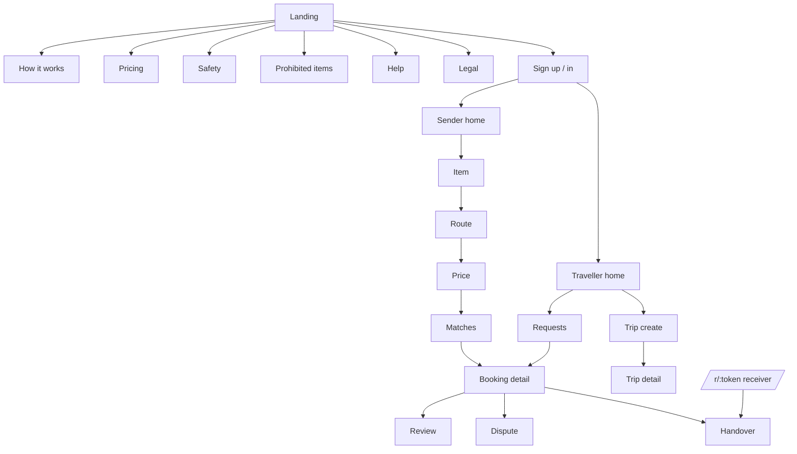

# Information Architecture

**Status:** Draft v0.1 · **Date:** 2026-10-24
Surfaces: responsive web (sender/traveller/receiver), Android app, protected admin console.

---

## 1. Design premise

Three facts drive the entire IA:

1. **The sender is anxious.** They are handing an object they care about to a stranger. The IA must
   answer "where is it, who has it, what if something goes wrong" within one tap.
2. **The traveller is impatient.** They are mid-journey. Anything that costs more than ~90 seconds
   before they can accept is a funnel leak.
3. **The receiver did not choose us.** They must never be forced to install an app to receive a
   parcel. Their entry point is an SMS link to a single-purpose web page.

So: **three different shells**, one design system. The receiver gets a *single page*, not a product.

## 2. Top-level structure

```
Public (no auth)
├── /                      Landing — what it is, what it costs, what we refuse to carry
├── /how-it-works          Sender path + traveller path, one page
├── /pricing               Published pricing method + estimate
├── /safety                Verification, OTP handover, what is not insured
├── /prohibited-items       Public list (a trust asset, not a legal footnote)
├── /help                  FAQ + contact
├── /legal/*               Terms, privacy, refunds, grievance officer
└── /r/:token              Receiver handover page (single purpose, expiring)

Sender (auth)
├── Home                   Active bookings + "send something" primary action
├── Send
│   ├── 1 Item              category, description, photo, weight, value
│   ├── 2 Route             origin/destination, window
│   ├── 3 Price             itemised breakdown, quote expiry
│   └── 4 Travellers        ranked matches, reasons, request booking
├── Booking detail         status, timeline, counterparty, handover, help
└── Profile                settings, privacy, payments, support

Traveller (auth)
├── Home                   Upcoming trips + requests awaiting me
├── Trip
│   ├── Create             route, date, windows, capacity, mode
│   └── Detail             capacity, accepted parcels, earnings
├── Requests               pending booking requests with a 30-min clock
├── Booking detail         same component as sender, different actions
└── Profile                verification, payout, reliability, settings

Admin (staff auth, separate origin)
├── Queue: Verifications
├── Queue: Bookings needing attention
├── Queue: Disputes
├── Queue: Payouts awaiting approval
├── Search (booking / user by hash)
├── Reconciliation
└── Audit log
```

## 3. Navigation models

### Web (sender/traveller)
- **Top bar** on desktop: logo, Send, Trips, Help, avatar menu.
- **Bottom tab bar** on mobile web: Home, Send, Trips, Help, Profile (5 items maximum).
- No hamburger for primary navigation — a drawer hides the two things that matter.
- The active booking is *always* reachable: a persistent slim status pill appears on every
  authenticated screen while a booking is in a non-terminal state.

### Android
- Same five bottom tabs.
- Push deep-links to booking detail, never to the home screen.
- Back always returns to the previous screen; the Android back button never exits the app from
  inside a handover flow without confirmation.

### Receiver web page
- **One screen, no navigation.** No login, no app install prompt, no marketing.
- Shows: parcel summary, traveller first name, OTP entry, "what to check" checklist, help number.
- Expires when the booking closes; expired links show a dead-end explanation and a support number.

### Admin
- Left rail with queues + counts; keyboard-first; no mobile layout (explicitly desktop-only).
- Every destructive action opens a confirmation with a mandatory reason code.

## 4. Content hierarchy rules

| Screen type | Must answer in the first viewport |
|---|---|
| Landing | What is this · what does it cost · is it safe · what can't I send |
| Send step | What do I do now · what happens next · can I go back |
| Match results | Who · when · how much · why this one |
| Booking detail | Where is it right now · what do I do next · how do I get help |
| Handover | Exactly one action, one field, one fallback |
| Error | What happened · what it means for my parcel · what to do now |

## 5. State model surfaced to users

Every list and detail screen must design for nine states. Omitting any of them is an incomplete
screen (checked in `testing/UAT_CHECKLIST.md`).

1. Loading (skeleton, not spinner-only)
2. Empty — first use
3. Empty — no results after filtering (with a way out)
4. Error — recoverable (retry)
5. Error — unrecoverable (contact support)
6. Offline
7. Pending verification
8. Rejected / blocked (with reason and appeal path)
9. Success / terminal

## 6. Deep-link map

| Link | Destination | Auth |
|---|---|---|
| `/r/:token` | Receiver handover | token only |
| `/b/:bookingId` | Booking detail | required |
| `/p/:parcelId` | Parcel detail | required |
| `/verify` | Verification status | required |
| `parcelyatra://booking/:id` | Android deep link | required |

Tokens in receiver links are single-use-ish: scoped to one booking, expire with the booking, and are
rate-limited. They are not user sessions and grant no other access.

## 7. What is deliberately absent

| Absent | Why |
|---|---|
| Live map with a moving dot | No continuous tracking (D-007); implying it exists would be dishonest |
| Social feed | Not the product |
| In-app wallet balance | Regulated; excluded |
| Public user profiles | Stalking surface |
| Star rating of *documents* | Meaningless and invites gaming |
| Chat with images | Moderation burden at pilot |
| "Coming soon: bus/train/air" | Modes are legally gated; advertising them is misleading |

## 8. Sitemap (machine-readable summary)


