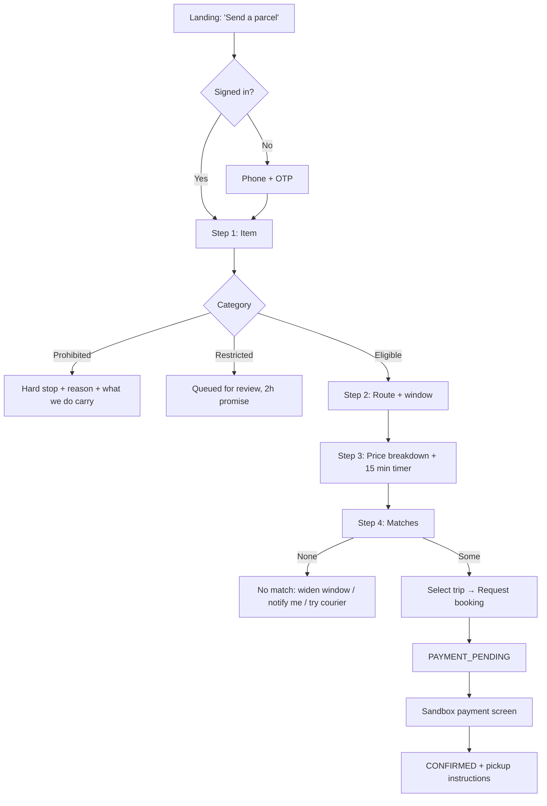
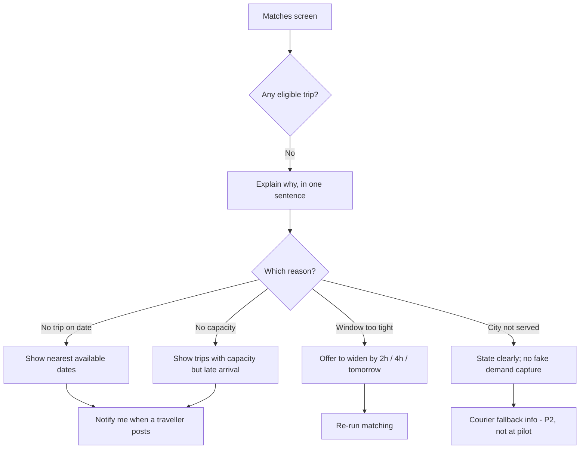
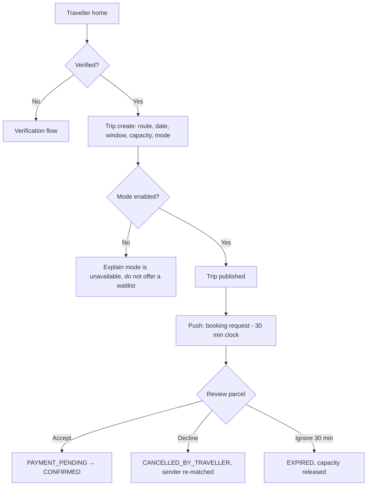
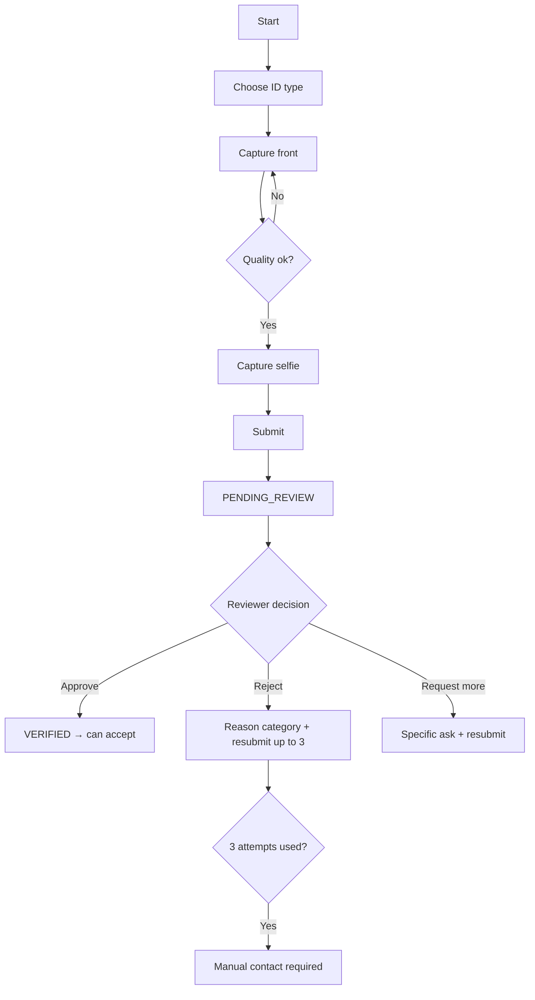
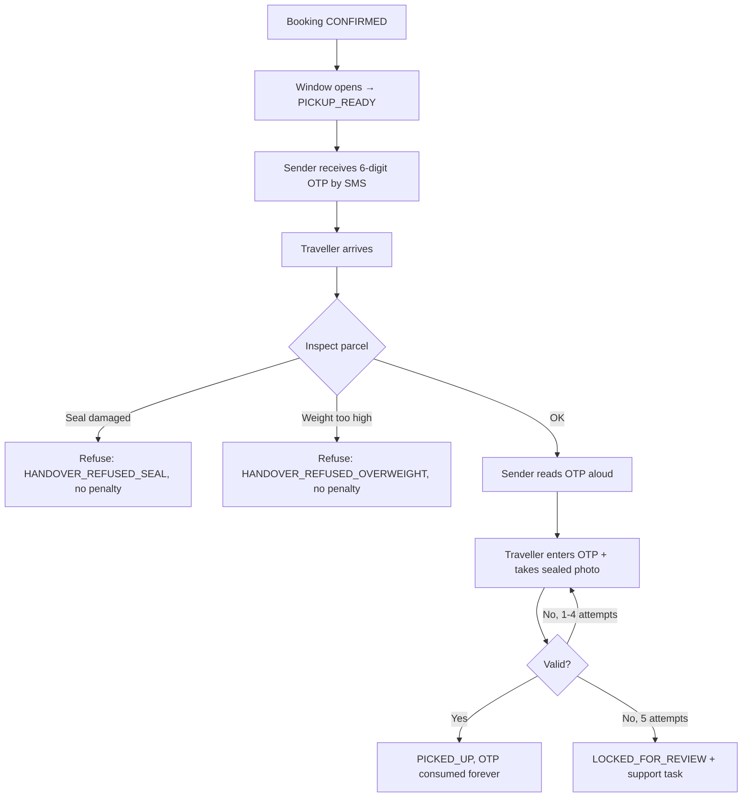
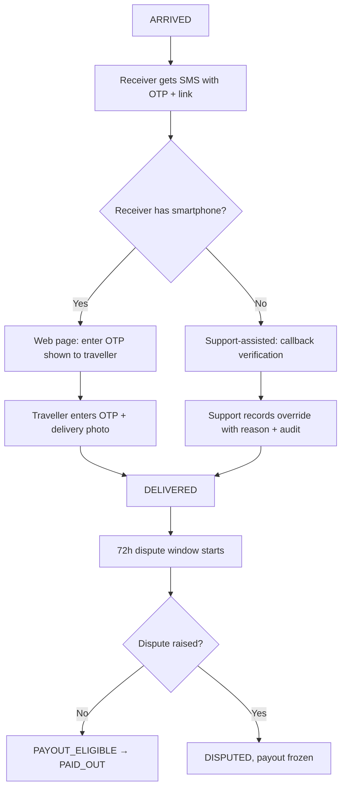
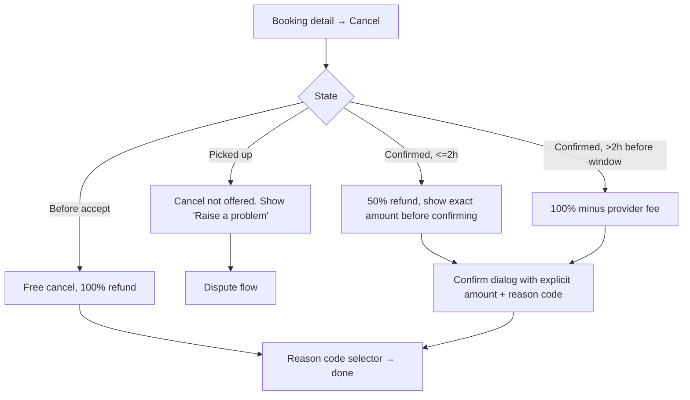
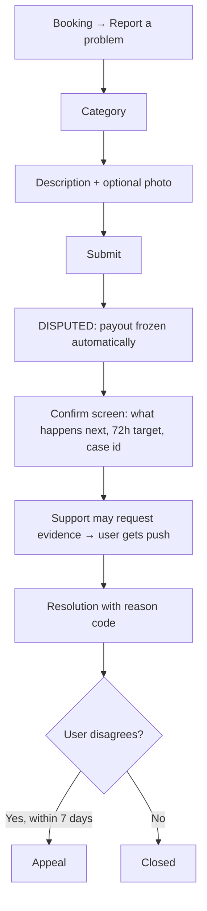
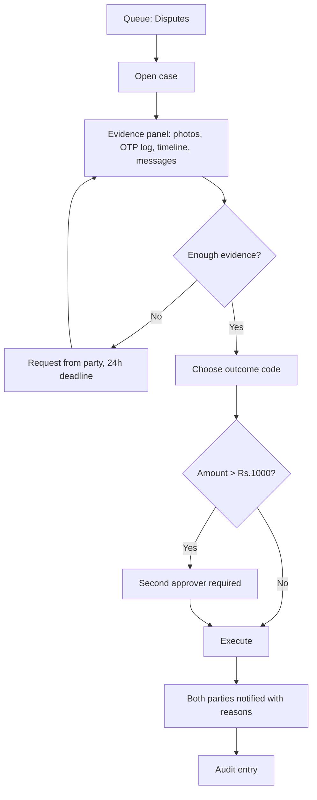

# User Flows

**Status:** Draft v0.1 · **Date:** 2026-10-24
Flows are written against the state machine in `docs/BOOKING_STATE_MACHINE.md` and the error codes in
`api/ERROR_CATALOG.md`. Every branch below has a corresponding test case.

---

## 1. Sender: first parcel (happy path)

**Time budget:** the target is under 4 minutes for a signed-in returning sender, under 7 minutes for
a first-time sender including OTP.

## 2. Sender: no match

The most commercially important flow, because it is where the marketplace fails the user.

**Rule:** never show a price when there is no match. A price implies availability.

## 3. Traveller: publish a trip and accept

**Traveller decision screen must show**: category, weight, declared-value band (not exact), pickup
area (not address), arrival window, their share in ₹, and the detour in minutes. Nothing else. Every
extra field is a reason to decline.

## 4. Verification (traveller)

Review SLA shown to the user: "usually within 12 hours". If the queue is slower than that, the app
must show the real current estimate, not the marketing number.

## 5. Handover: pickup

**Offline branch:** the traveller may have no signal. The screen must queue the submission and retry;
the OTP is validated server-side, so an offline "success" is impossible and must never be faked in
the UI. Copy: "No signal — we'll confirm as soon as you're back online. Keep the parcel."

## 6. Handover: delivery

**Receiver no-show:** after 2 hours at destination the traveller may mark
`DELIVERY_ATTEMPT_FAILED` and chooses: hold 24 h, hand to a support point (P2), or return. The UI
must never suggest abandoning the parcel.

## 7. Cancellation

**Rule:** the refund amount is shown as a number *before* the user confirms. No "you may be eligible
for a partial refund".

## 8. Dispute

The user must be told, at submission, that **payout to the traveller is paused** — not doing so is a
transparency failure.

## 9. Payment states surfaced to the user

| Internal state | What the screen says | Allowed action |
|---|---|---|
| `payment_pending` (creating) | "Setting up payment…" | Wait |
| `payment_pending` (provider slow) | "We're confirming with your bank" | Wait, do not retry |
| `authorised` | "Payment confirmed" | Continue |
| `failed` (definitive) | "Payment didn't go through. Your booking was cancelled." | Retry with new booking |
| unknown | "We're not sure yet — we'll text you." | None; support follows up |

**Never** show a retry button while payment state is unknown. Double capture is worse than a delay.

## 10. Admin: dispute resolution

Admin UI constraint: the "execute" button is disabled until an outcome code **and** a free-text
justification of ≥ 20 characters exist. This is friction by design.

## 11. Flow-level acceptance criteria

| Flow | Criterion |
|---|---|
| Send | Completable in < 4 min (returning) / < 7 min (new) on a 3G connection |
| Send | Abandonment at any step preserves entered data for 24 h |
| Accept | Traveller can decide from the notification alone (all decision data in the push payload minus PII) |
| Handover | Works with 0 bars; queues and retries without duplicating the OTP consumption |
| Receiver | Completable by a first-time user on a feature phone via SMS link, no app |
| Dispute | Payout freeze is visible to both parties immediately |
| All | Every error state has a next action; no dead ends |

## 12. Flows explicitly not designed at pilot

- Multi-parcel consolidated shipments.
- Recurring/scheduled bookings.
- Business accounts with multiple users.
- In-app wallet top-up.
- Live map tracking.
- Returning a delivered parcel.

Each is absent rather than half-built (see `docs/MVP_SCOPE_AND_NON_GOALS.md`).
